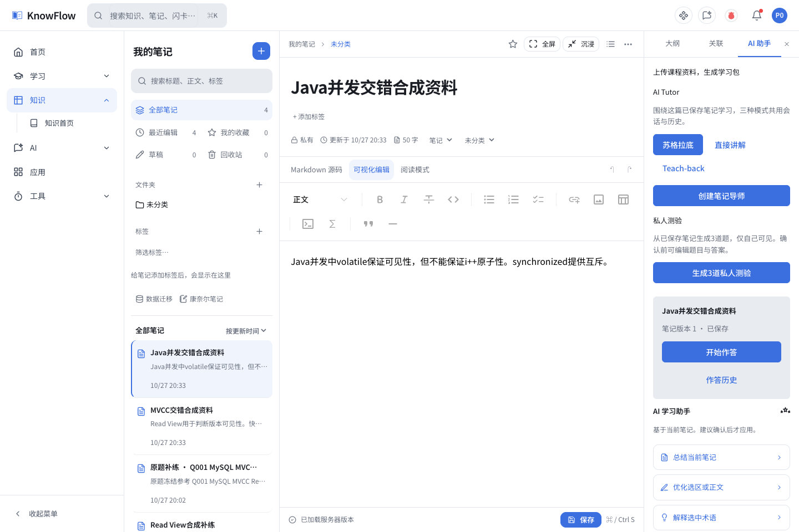
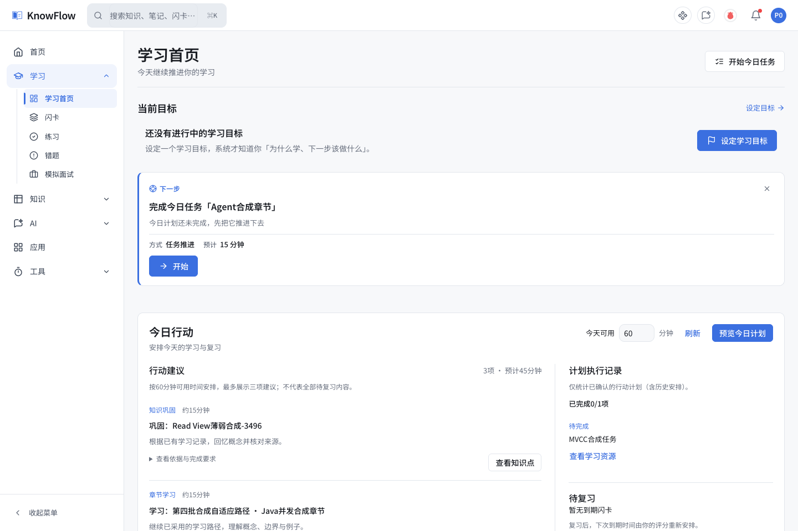
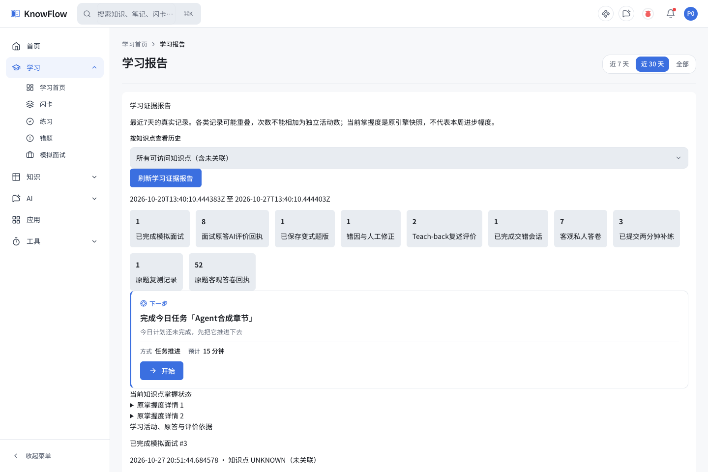

<div align="right">
  <strong>简体中文</strong> · <a href="README.en.md">English</a>
</div>

# KnowFlow

**把资料变成可以提问、练习、复述和复习的个人知识库。**

KnowFlow 是一个 Java + Vue 全栈知识管理与 AI 学习项目：从文档和笔记出发，连接学习导师、私人测验、FSRS 复习、面试练习与有来源的学习证据。

[最新功能](#最新学习功能) · [本地运行](#本地运行) · [功能开关](#可选学习功能开关) · [验证与边界](#验证与边界)

## 界面预览

**笔记工作区与 AI 学习助手**



| 学习行动中心 | 学习证据报告 |
| :---: | :---: |
|  |  |

*截图来自本地隔离演示环境，使用合成 Java / MySQL 学习资料；展示的记录和分数不代表真实用户效果。部分功能需启用下方开关。当前界面以中文为主。*

## 从知识管理到学习闭环

- **管理资料**：文档、分类、搜索、收藏、阅读进度，以及服务端保存的普通笔记；笔记支持 Markdown / 可视化编辑、版本历史和来源关联。
- **基于来源学习**：RAG 问答与文档引用；在阅读中选区提问，围绕已保存笔记切换导师模式，确认后再采纳 AI 建议。
- **真正动手练习**：私人测验、规则题库与考试、错题、两分钟补练、原题复测、变式和交错练习；可客观判分的题目复用原判分服务。
- **安排下一步**：学习路径与章节依赖、统一 NextAction、任务和时间预算、FSRS-6 闪卡复习、可解释的个人路径调整。
- **回看真实依据**：知识图谱掌握状态、原始答卷、复述评价、提示条件、人工错因修正和复测记录。AI 评价、客观成绩与活动次数分开呈现。

## 最新学习功能

截至 **2026-10-27**，下列 **16 项功能已交付最小可运行切片**。这不表示所有高级规格或生产发布已完成。

| 阶段 | 已实现的功能 |
| --- | --- |
| 资料 → 学习 | **F03 私人测验**：笔记出题、预览确认、冻结题版与客观答卷；**F16 三模式 Tutor**：苏格拉底 / 直接讲解 / Teach-back 共用会话与历史；**F17 AI 学习包**：TXT、Markdown、文本型 PDF 的受控导入、分项产物、重试与采纳。 |
| 阅读 → 理解 | **F10 选区问答**：保留原文与版本上下文；**F05 分级提示**：逐步提示、显式揭晓与使用记录；**F02 Teach-back 评价**：保留原始复述、来源引文与再次复述；**F07 两分钟补练**：短学习内容、原单题作答与历史。 |
| 错误 → 再练 | **F08 错因分类**：有依据的 AI 建议、UNKNOWN 与人工修正；**F04 原题复测**：补练后冻结同题复测与历史比较；**F09 变式题**：两种场景、确认后保存私人题版；**F13 模拟面试**：通用岗位方向、可访问专题、三题文字面试与相关追问。 |
| 证据 → 调整 | **F06 图谱掌握度**：实体色 / 掌握状态切换、证据与复测联动；**F01 自适应路径**：有来源建议、章节锁定和个人顺序版本；**F14 计划重排**：预算内预览、锁定 / 截止保护、缩短与延期；**F15 交错练习**：两个专题交替组成 4–6 题；**F12 证据报告**：最近 7 天原始记录、知识点过滤与来源核查。 |

**F11 Java 自动评测仍待独立隔离沙箱，不作为已交付能力。** 普通宿主机运行能力不等于安全执行不可信代码。

## 更多基础能力

- **知识库协作**：OWNER / EDITOR / READER 角色与服务端资源权限校验。
- **AI 对话**：多轮会话、流式回复、模型配置与来源引用；可配置兼容的模型服务，AI 调用需要可用凭据。
- **复习与任务**：FSRS-6 闪卡、错题、学习目标、章节进度、任务清单、日历和番茄钟。
- **知识工作台**：知识整理、回忆练习、康奈尔笔记、费曼表达，以及思维导图 / 绘图等工具。
- **编程辅助**：代码题与编辑界面、工具调用和 Agent 工作流；宿主机工具及执行能力受独立开关和授权约束。

## 常用入口

| 页面 | 路径 |
| --- | --- |
| 笔记与学习助手 | `/notes` |
| 学习中心 / 路径 | `/learning/center` · `/learning/paths` |
| 今日计划 | `/learning/today-plan` |
| 闪卡复习 | `/learning/flashcards` |
| 题库与交错练习 | `/learning/quiz` |
| 知识图谱 | `/learning/knowledge-graph` |
| 学习证据报告 | `/learning/report` |
| 模拟面试 | `/interview` |
| AI 学习包（需开关） | `/learning/study-packs` |

## 技术栈

| 层 | 技术 |
| --- | --- |
| 后端 | Java 17、Spring Boot 3.2.5、Spring Security、JWT、MyBatis Plus、JdbcTemplate |
| 前端 | Vue 3、TypeScript、Vite、Pinia、Vue Router、Tailwind CSS |
| 编辑与可视化 | Milkdown、Markdown、Mermaid、Dagre、Vue Flow |
| 数据与学习 | 开发用 H2、MySQL 支持、FSRS-6、原始学习事件与证据回执 |
| AI 与资料处理 | 可配置模型服务、SSE、RAG、Apache Tika |

## 本地运行

需要 **JDK 17、Maven、Node.js `^20.19.0` 或 `>=22.12.0`**（遵循当前 Vite 的 engines）。以下命令使用 Bash；先确认 8080 / 5173 未被其他服务占用。

```bash
git clone https://github.com/beiluoL/knowflow.git
cd knowflow
```

启动后端：

```bash
cd backend
export JWT_SECRET="$(openssl rand -hex 32)"
export KNOWFLOW_AI_CAPABILITY_ENABLED=false
mvn spring-boot:run
```

另开终端启动前端：

```bash
cd frontend
npm ci
npm run dev
```

访问 `http://localhost:5173`。默认使用 H2 内存数据库，重启后数据不保留；需要持久化时再配置文件 H2 或 MySQL。不要直接连接正式数据库做开发验证。

AI 并非基础浏览、规则答题与复习流程的必需条件。启用 AI 时配置自己的模型服务和凭据，并打开 AI 总开关。可参考 [本地配置示例](backend/src/main/resources/application-local.example.yml)；真实的 `application-local.yml`、`.env` 和密钥不应提交。

## 可选学习功能开关

新增学习模块默认关闭；前后端开关需配套启用，并满足模块间依赖。

| 模块 | 后端属性 | 前端环境变量 |
| --- | --- | --- |
| 私人测验 | `knowflow.product.private-quiz.enabled` | `VITE_PRODUCT_PRIVATE_QUIZ` |
| 三模式导师 | `knowflow.product.tutor.enabled` | `VITE_PRODUCT_TUTOR` |
| 学习包 | `knowflow.product.study-pack.enabled` | `VITE_PRODUCT_STUDY_PACK` |
| 提示 / 复述 / 补练 | `knowflow.product.tutor-coaching.enabled` | `VITE_PRODUCT_TUTOR_COACHING` |
| 错因 / 复测 / 变式 / 面试 | `knowflow.product.interview-learning.enabled` | `VITE_PRODUCT_INTERVIEW_LEARNING` |
| 图谱 / 路径 / 重排 / 交错 / 报告 | `knowflow.product.adaptive-learning.enabled` | `VITE_PRODUCT_ADAPTIVE_LEARNING` |

后端可在本地配置或启动参数中设为 `true`，前端环境变量同样设为 `true` 并重启 Vite。完整学习闭环依赖上述模块组合，单开界面开关不会绕过后端校验。AI 模块还需启用 `knowflow.ai.capability.enabled` 并配置模型。

## 验证与边界

本地验证快照（2026-10-27）：

- 前端 **237 个测试文件、1,750 项通过**；类型检查与构建通过。
- 第四批后端受影响范围 **47 项通过**，最终加固 **12 项通过**，两组有重复覆盖，不能相加为独立测试数。
- 16 项学习功能分批进行过隔离验收；第四批五项完成真实浏览器操作、保存、刷新与重新登录验证，第四批新增云调用为 0。
- 后端最近一次全量结果是第三批的历史记录：1,175 项中 1,165 通过、1 个既有 `888001` 夹具错误、9 跳过；未宣称后端全量通过。

```bash
# 在仓库根目录执行
(cd frontend && npx vitest run && npx vue-tsc --noEmit && npm run build)

# 后端相关合同测试
(cd backend && mvn -Dtest=ProductGraphInsightHttpTest,ProductAdaptivePathHttpTest,ProductSmartPlanHttpTest,ProductInterleavedHttpTest,ProductEvidenceReportHttpTest test)
```

AI 评分不等于客观成绩；原始首轮不明时保持 UNKNOWN，条件不一致的成绩不输出虚假进步幅度。默认关闭的 Host / Judge 能力不应作为生产安全沙箱。

**当前全局发布状态：NOT_READY。** MySQL / 生产迁移、部署与发布门禁尚未认证，T03/T04 仍未完成。当前主要开发对象是普通用户 PC 界面；窄屏检查不代表已交付独立移动客户端。

## 仓库与维护者

[GitHub](https://github.com/beiluoL/knowflow) · [Gitee](https://gitee.com/beiluol/knowflow) · [Beiluo — Java Backend × AI Application Engineer](https://github.com/beiluoL)
