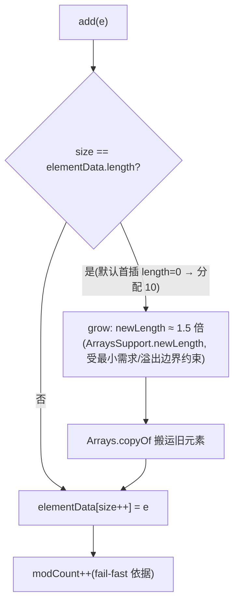

# ArrayList：底层结构、扩容机制与 fail-fast 迭代

## 1. 学习目标

- 讲清 `ArrayList` 的底层是**动态数组**（`elementData`），`size` 与 `capacity` 是两回事。
- 理解扩容：本章JDK17的 `add(E)` → 私有 `add(e,elementData,size)` → 必要时 `grow` → `ArraysSupport.newLength`；普通增长优选约1.5倍，但受最小需求与溢出边界约束。默认构造首次add通常分配10。
- 理解 `modCount` 与 **fail-fast**：迭代器在适用检查点发现结构修改时可抛 `ConcurrentModificationException`，这是尽力检测而非保证；不能依赖它实现并发正确性。
- 能解释 `subList` 是**视图**而非拷贝，以及为何 `trimToSize` 在批量添加后有用。

## 2. 问题动机

数组长度固定，业务里元素数量常是运行期才知道的。若每次满都 `new` 一个更大数组并拷贝，频繁 `add` 的成本会很高。我们需要一个「自动变长」的数组容器：`ArrayList` 用**成倍预留容量 + 必要时拷贝**来摊还成本，使 `add` 的均摊时间为 O(1)。

另一个动机是**错误修改的尽力检测**：单线程用迭代器遍历时，若别的代码（或自己用 `list.remove`）在中途改了结构，继续遍历会得到错乱结果。ArrayList 用 `modCount` 让迭代器在「发现被偷偷改了」时立刻失败，而不是带着错误数据静默跑下去。

## 3. 直观理解（类比）

`ArrayList` 像一个**带伸缩功能的有序货架**：默认货道先不分配格子，第一次装货才通常留10个格子；装满后再进货时，管理员建一条 15 个格子的新货道（1.5 倍），把旧货搬过去。货架上贴了张「修改次数单」`modCount`；盘点员（迭代器）开工前记下单号，盘点中若发现单号变了（有人动了货），在检查点举手报错；若后续没有到检查点，也可能不报错。类比不提供线程安全或检测必达保证。

## 4. 专业术语

- **elementData**：实际存元素的 `Object[]`（JDK 7+ 非序列化字段，按需序列化）。
- **size**：当前元素个数；**capacity** = `elementData.length`（容量）。
- **grow / ArraysSupport.newLength**：本版容量计算与复制；旧版的hugeCapacity不能当成本版ArrayList方法。
- **modCount**：结构修改计数器，供迭代器做 fail-fast 校验。
- **fail-fast**：迭代器发现 `modCount` 与自身记录不符即抛 `ConcurrentModificationException`。
- **subList**：返回原 list 的**视图**，操作会反映到原 list。

## 5. 知识结构地图

```text
add(E)：modCount++ → add(e, elementData, size)
  size == capacity → grow(size+1)
    默认空数组标记 → max(10,minCapacity)
    其他 → ArraysSupport.newLength(old,minGrowth,old>>1)
           → Arrays.copyOf
  写入 elementData[size]，size++

迭代: Itr 记录 expectedModCount = modCount
       next() 先 checkForComodification(): modCount != expected → CME
```

- **前置**：[HashMap 定位与 put](hashmap.md)（同样用数组+扩容思想）、[equals/hashCode 契约](equals-hashcode.md)（`contains/indexOf` 依赖 `equals`）。
- **后续关联**：[LinkedList](linkedlist.md)（对比数组 vs 链表）、集合迭代与一致性视图（规划中）。

## 6. 核心技术原理

- 本章JDK17默认构造器使用特殊标记空数组（首次 `add` 才扩到 10）；指定 `initialCapacity` 则直接建对应大小数组。
- `add` 流程：`size+1` 是否超过 `elementData.length`？是则 `grow`。`grow` 计算 `newCapacity = oldCapacity + (oldCapacity >> 1)`（右移一位=除以 2，故约 1.5 倍），再 `Arrays.copyOf` 拷贝；若仍不够则用 `minCapacity`（如 `addAll` 大集合）。
- `ensureCapacity(int min)` 是公共方法，可**提前**扩容避免多次 `grow`（批量插入前调用能省拷贝）。
- `modCount` 在 `add/remove/clear/addAll` 等**结构性修改**时自增；`Itr`（迭代器）构造时记 `expectedModCount = modCount`，每次 `next/remove` 前比对，不等即抛 `CME`。
- `subList(from,to)` 返回 `SubList`（内部类），**没有复制元素**；对子列表的改动直接作用于原 list，且会改 `modCount`。

> 版本边界：这里仅保证已核对的17.0.14+7。JDK7不同更新版的历史变化不以“7+”笼统概括；显式new ArrayList<>(0)首次add容量为1，与默认构造不同。

## 7. 源码与底层实现（基于 OpenJDK 17 公开行为）

- 字段：`transient Object[] elementData; private int size; protected transient int modCount;`
- `grow(int minCapacity)`：默认特殊空数组分支分配max(10,minCapacity)；其他分支调用 `ArraysSupport.newLength(oldCapacity,minCapacity-oldCapacity,oldCapacity>>1)`，再copyOf。普通容量呈10→15→22→33，最小需求和极大数组由newLength/hugeLength处理，不能无条件乘1.5。
- `Itr.next()`：`checkForComodification();` 即 `if (modCount != expectedModCount) throw new ConcurrentModificationException();`
- `subList` 的 `add/remove` 会调用外层的 `ArrayList.this.add/remove` 并更新视图size/modCount等状态，所以外部也能看到变更；不要误解为额外无条件再加一次计数。

> ⚠️ 上述字段名与分支依据 OpenJDK 17 源码结构描述；验证工程通过**反射读取 `elementData.length`** 与**观察 `modCount` 抛异常行为**来佐证，而非逐行引用源码行号。

## 8. 完整执行流程

```text
默认 list.add("x")：modCount++ → 私有add发现size==length
  → grow(1)识别默认空数组 → new Object[10] → 写入，size=1
第11个add：grow(11) → newLength(10,1,5)=15 → copyOf → 写入
显式new ArrayList<>(0)：grow(1)不是默认标记 → newLength(0,1,0)=1
迭代器next检查修改计数；hasNext只检查cursor!=size，可能提前结束而不抛CME

```

## 9. 企业业务需求

- **DTO/结果集收集**：接口返回 `List<Order>` 多用 `ArrayList` 装载。
- **批量导入**：先 `new ArrayList<>(expectedSize)` 或 `ensureCapacity`，避免反复 1.5x 拷贝拖慢导入。
- **遍历中删除**：用 `Iterator.remove()` 而非 `fori` 里 `list.remove(i)`，否则既可能漏元素又会触发 fail-fast 或索引错位。
- **分页/子段处理**：`subList` 做分段，但要注意它是视图、且外部修改会影响它。

## 10. Spring Boot 项目架构

在 Spring Boot 服务里，典型的「查询→组装→返回」：Mapper 返回 `ArrayList`，Service 用 `forEach/stream` 转换，Controller 返回 `List<Vo>`。注意：根据所有权决定是否复制 `subList`：跨边界需要独立容器时用 `new ArrayList<>(list.subList(...))`。不能笼统说序列化器不支持视图；复制理由是解除容器结构共享，元素对象仍是浅拷贝。

```text
Controller → Service → Mapper(返回 ArrayList) → 转换为 Vo → 返回 List<Vo>
```

## 11. 完整代码与验证

```java
ArrayList<String> list = new ArrayList<>(2);  // 预分配容量 2
list.add("a"); list.add("b");
list.ensureCapacity(100);                // 提前扩容，避免多次 grow
list.add("c");
// 迭代中安全删除用迭代器
Iterator<String> it = list.iterator();
while (it.hasNext()) {
    if ("b".equals(it.next())) it.remove();   // 安全：不会触发 CME
}
// 错误示范：此处剩[a,c]，删除a后可能直接结束并漏遍历c，不抛CME：
// for (String s : list) { if (s.equals("a")) list.remove(s); }
```

## 12. 环境运行与验证

- 工程：`examples/arraylist-verify/`，环境 **OpenJDK 17.0.14 + Maven 3.8.3**，依赖 `junit-jupiter` + `assertj-core`。
- 复现命令：

```bash
cd examples/arraylist-verify && mvn -q test
```

- 本轮实际结果见[日志](../../99-maintenance/evidence/batch-18/arraylist-test.txt)：`Tests run: 8, Failures: 0, Errors: 0, BUILD SUCCESS`（断言：添加第 11 个元素后 `elementData.length` 经反射读为 15；`ensureCapacity(100)` 后容量 ≥100；`for-each` 中移除首元素触发 `CME`；`Iterator.remove` 不触发；`subList` 改动反映到原 list）。

## 13. 企业工程分析

- **预估容量是性价比最高的优化**：知道大概数量就传 `initialCapacity`，或在批量 `addAll` 前 `ensureCapacity`，把多次 1.5x 拷贝压成一次。
- **fail-fast 不是线程安全**：`modCount` 只是单线程下「检测偷偷修改」的机制，**不保证并发安全**；多线程写要用 `CopyOnWriteArrayList` 或加锁。
- **subList 陷阱**：它是视图，原 list 结构变化会让子列表失效；序列化/跨方法传递前先 `new ArrayList<>(sub)`。
- **随机访问友好、插入中间贵**：`get(i)` O(1)、`add(0, e)` / `remove(i)` 需 `System.arraycopy` 搬移 O(n)。

## 14. 技术对比与选型

| 容器 | 底层 | 随机读 | 头插/中间插 | 线程安全 | 适用 |
|---|---|---|---|---|---|
| ArrayList | 动态数组 | O(1) | O(n) 搬移 | 否(fail-fast) | 读多写少、尾部追加 |
| LinkedList | 双向链表 | O(n) | O(1) 有节点 | 否 | 频繁头尾/中间插删 |
| CopyOnWriteArrayList | 数组副本 | O(1) | O(n) 复制 | 是(读无锁) | 读极多写极少 |
| Vector | 数组 | O(1) | O(n) | 是(方法 synchronized) | 遗留，基本不用 |

## 15. 常见错误与反例

- **遍历中用 `list.remove`**（for-each 或 fori） → 可能CME，也可能提前结束、漏删或越界；不是每次必报错。正确做法：`Iterator.remove()`。
- **以为 `subList` 是独立副本** → 改原 list 后子列表抛 `CME`；或序列化视图出问题。
- **频繁 `add` 不预估容量** → 反复 1.5x 拷贝，大批量导入性能差。
- **误用 `trimToSize` 在还会继续 add 的场景** → 之后又立刻扩容，白做无用功；只在「确定不再增长」后调用以省内存。

## 16. 标准面试回答（话术）

**30秒**：动态数组，size与capacity分离；尾部追加均摊O(1)，扩容复制为O(n)。默认空标记首增通常10，普通增长优选约1.5倍。fail-fast尽力检测错误修改，不是线程安全。

**90秒**：

> ArrayList 底层是 `Object[] elementData`，`size` 是元素数、容量是数组长度。默认空数组，首次 add 扩到 10；之后满了就 `grow`，新容量是旧的 1.5 倍（旧 + 旧>>1），用 `Arrays.copyOf` 拷贝。所以 `add` 均摊 O(1)。迭代器靠 `modCount` 做 fail-fast：在检查点发现结构被改可抛 `CME`，但不保证每次都发现——注意这只是失败快速暴露，不是线程安全。读多写少、尤其尾部追加时选它；LinkedList只有已定位节点或迭代器位置时插删才O(1)，从索引找位置仍需O(n)，应按实际访问模式测量。

**深入版**：17.0.14+7中add递增modCount，私有add按满容量调用grow；grow区分默认空数组与其他情况，后者调用ArraysSupport.newLength。Itr.next检查expectedModCount，hasNext只看cursor与size，因此两元素列表删首元素可提前结束而不抛CME。subList共享容器结构，脱离结构共享需复制，元素仍共享引用。

## 17. 高频追问与主动回忆

- 扩容倍数是多少？为什么是 1.5 而不是 2？（旧 + 旧>>1；1.5 在内存浪费与拷贝次数间折中）
- 初始容量真的是 10 吗？（本章JDK17默认构造延迟分配，首次add通常10；显式零容量首次为1）
- `modCount` 能当并发安全用吗？（不能，只是单线程 fail-fast 检测）
- 为什么 `for-each` 里 `remove` 会 CME，而 `Iterator.remove()` 不会？（后者会同步 `expectedModCount`）
- `subList` 修改会影响原 list 吗？（会，它是视图）

## 18. 五层总结

1. **是什么**：基于动态数组的 `List`，自动扩容。
2. **为什么**：数组定长，业务需变长容器且要均摊 O(1) 追加。
3. **怎么做**：满则 1.5x 扩容 + 拷贝；迭代器用 `modCount` 暴露并发/偷偷修改。
4. **约束边界**：非线程安全、中间插入 O(n)、`subList` 是视图。
5. **怎么用**：预估容量、用迭代器删除、`CopyOnWriteArrayList` 应对读多写少并发。

## 19. 知识关联

- → [LinkedList](linkedlist.md)：链表 O(1) 插删 vs 数组 O(n) 搬移，选型对照。
- → [HashMap](hashmap.md)：同样「数组+扩容」思想，但 HashMap 扩容是 2 倍且搬移同时重哈希。
- → [equals/hashCode 契约](equals-hashcode.md)：`indexOf/contains` 依赖 `equals` 判等。

## 20. 事实标记

V8.1复核依据：[固定17.0.14+7原件与SHA](../../99-maintenance/evidence/batch-18/source/PROVENANCE.json)。本轮修正历史方法串用、无效接口类型代码和fail-fast必抛的断言，新增显式零容量与无CME反例测试。


- ✅ **已执行**：`examples/arraylist-verify` 验证工程（8/8），反射读取 `elementData.length` 验证 10→15 扩容、容量预分配，并复现 fail-fast 与 `Iterator.remove` 差异。
- 📄 **源文档陈述**：`elementData`/`size`/`modCount` 字段、`grow` 的 1.5x 分支、`Itr.checkForComodification` 行为来自 OpenJDK 17 源码结构描述。
- ⚠️ **未验证**：未逐行引用 OpenJDK 源码行号；`ArraysSupport.newLength/hugeLength` 极大数组与溢出边界未实测；并发正确性未做多线程实测（fail-fast ≠ 线程安全已明确标注）。

## V8.1 教学补充

| 英文 | 中文 | 作用 |
|---|---|---|
| Capacity | 容量 | 底层数组能装多少元素 |
| Amortized complexity | 均摊复杂度 | 把少数扩容成本分摊到多次追加 |
| Structural modification | 结构修改 | 改变元素数量等影响遍历结构的操作 |
| View | 视图 | 与原容器共享结构的访问窗口 |

理解层：容量不等于元素数。源码层：add/grow/newLength与检查点。工程层：本章豁免重复Boot工程，纯JDK实验更直接验证容器；第10节为架构应用说明，不是已交付HTTP服务。面试层：说明约1.5倍条件与尽力检测边界。记忆层：1天画数组、3天复跑零容量、7天复现无CME反例、14天查newLength、30天按数据规模重新选型。

## add 与扩容流程（V18 复核增补）



锚点（本章 JDK17 源码导读）：`add(E)` → 私有 `add(e, elementData, size)` → 必要时 `grow`；默认构造首次 add 通常分配 10，普通增长优选约 **1.5 倍**。
