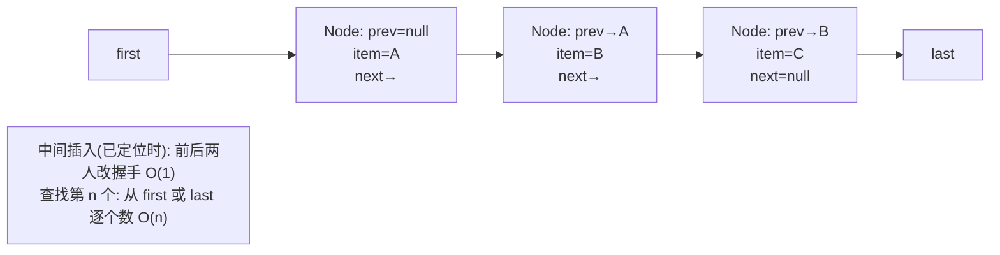

# LinkedList：双向链表实现、插入代价与随机访问边界

## 1. 学习目标

- 理解 `LinkedList` 是**双向链表**，每个元素包成 `Node`（前驱 `prev` + 值 `item` + 后继 `next`）。
- 讲清头尾操作是 **O(1)**，而 `get(i)` / `set(i)` 是 **O(n)**（必须从头/尾遍历到目标）。
- 能说清它与 `ArrayList` 的取舍：**频繁头尾/中间插删选它；随机访问/遍历读多写少选 ArrayList**。
- 理解 `LinkedList` **不是 `RandomAccess`**，也**不缓存大小**，且每个元素有额外对象头开销（内存更大、缓存不友好）。

## 2. 问题动机

`ArrayList` 在中间/头部插入要 `System.arraycopy` 搬移大量元素（O(n)）。如果业务模式是「频繁在头部加、在尾部取、或在已知节点附近插删」，数组的搬移成本就浪费了。链表用「节点之间改指针」把这类操作降到 O(1)，代价是放弃了 O(1) 随机访问。

另一动机是 **`Deque` 语义**：`LinkedList` 同时实现了 `Queue`/`Deque`，可被当双端队列用（`offer/poll/peek`、`push/pop`、`addFirst/removeLast`）。

## 3. 直观理解（类比）

把 `LinkedList` 想成一列**手拉手的排队的人**：每个人（`Node`）只认识前面和后面那位。要在队伍中间塞一个人，只需让前后两人改握手（O(1)）；但要找「第 50 个人」，只能从队首或队尾一个个数过去（O(n)）。而 `ArrayList` 像一排带编号的储物柜，凭号直接开（O(1)），但中间塞东西得把后面所有柜子往后挪。

## 4. 专业术语

- **Node**：`private static class Node<E>{ E item; Node<E> next; Node<E> prev; }`。
- **first / last**：指向头、尾节点的引用；`size` 记录长度。
- **RandomAccess**：标记接口；`LinkedList` **未实现**，因此 `Collections.binarySearch` 等会对它走迭代而非索引。
- **Deque / Queue**：`LinkedList` 实现了双端队列，可作栈/队列。
- **linkFirst / linkLast / linkBefore**：内部维护指针的方法。

## 5. 知识结构地图

```text
addFirst(e) ─▶ Node(e,null,first); first.prev=newnode; first=newnode; size++; modCount++   (O(1))
addLast(e)  ─▶ 类似，动 last                                                       (O(1))
get(i)      ─▶ i<size/2? 从 first 顺推 : 从 last 逆推，到第 i 个                      (O(n))
remove(node)─▶ node.prev.next=node.next; node.next.prev=node.prev; size--; modCount++ (O(1) 已知节点)
```

- **前置**：[ArrayList](arraylist.md)（数组实现对照）、[equals/hashCode 契约](equals-hashcode.md)。
- **后续关联**：集合迭代与一致性视图（规划中）、[HashMap 树化](hashmap.md)（TreeNode 也是双向链表思想）。

## 6. 核心技术原理

- 每个节点持有 `prev`/`next`，整条链通过 `first`/`last` 锚定首尾；插入头尾只改 2~3 个指针，O(1)。
- `get(int index)`：`checkElementIndex` 后，若 `index < (size >> 1)` 从 `first` 正向走，否则从 `last` 反向走，步长为 index——所以最坏 O(n)，平均也要走 n/2 步。
- `remove(Object)` 需要先 `indexOf`（O(n) 遍历 + `equals` 比较）找到节点，再 O(1) 解链。
- **不是 `RandomAccess`**：`for (int i=0;i<list.size();i++) list.get(i)` 在这种列表上是 **O(n²)**（每次 get 都重头遍历），应改用增强 for（迭代器）或 `ListIterator`。
- 实现 `Deque`：`push/pop` 走头部，`offer/poll` 走尾部，`peek` 看头不删。

> ⚠️ 「从两端就近遍历」(`index < size/2`) 是 OpenJDK 的明确优化；其余为链表通用事实。

## 7. 源码与底层实现（基于 OpenJDK 17 公开行为）

- 内部类 `Node<E>`：`item`、`next`、`prev` 三个字段。
- `linkFirst(E e)`：`final Node<E> f = first; final Node<E> newNode = new Node<>(null, e, f); first = newNode; if (f == null) last = newNode; else f.prev = newNode; size++; modCount++;`
- `node(int index)`：上述双向就近遍历的核心方法。
- `ListItr` 是双向迭代器（`previous()`/`next()` 都 O(1)，因为它维护 `next/prev` 游标）。

> ⚠️ 字段名与方法分支依据 OpenJDK 17 源码结构描述；验证工程通过**可观察行为**（顺序、计数、非 RandomAccess、双向迭代）佐证，未逐行引用行号。

## 8. 完整执行流程

```java
list.addFirst("x")
  newNode(item=null, e="x", next=oldFirst)
  oldFirst.prev = newNode; first = newNode; size++; modCount++

list.get(3)  (假设 size=10, 3<5)
  从 first 出发, 走 3 步到目标节点, 返回 node.item   // O(n)

list.remove("a")
  indexOf("a") 遍历找节点(用 equals) → node
  node.prev.next = node.next; node.next.prev = node.prev; size--; modCount++
```

## 9. 企业业务需求

- **双端队列 / 栈 / 队列**：任务缓冲、 undo 栈、BFS 队列，用 `ArrayDeque` 更优但 `LinkedList` 也能顶（且历史代码常见）。
- **频繁头插**：日志收集、最新消息置顶等「总是在头部加」的场景（O(1)）。
- **已知节点附近的插删**：如维护一个有序链、在遍历中安全删除（`ListIterator.remove` O(1)）。
- **警惕**：不要拿它做「按索引随机访问 + 遍历修改」的重活，那是 ArrayList 的活。

## 10. Spring Boot 项目架构

在 Web 项目里，`LinkedList` 多见于工具/算法代码而非主数据装载（主数据多用 ArrayList）。若实现「操作审计栈」「最近访问 N 条」等，可用它作双端结构；但高并发读多写少应优先 `ArrayDeque`（无并发安全）或 `ConcurrentLinkedDeque`（并发）。

```java
Service 内部: Deque<AuditEvent> stack = new LinkedList<>(); // 或 ArrayDeque
```

## 11. 完整代码与验证

```java
Deque<String> dq = new LinkedList<>();
dq.addFirst("b");
dq.addLast("c");
dq.push("a");          // 头部
dq.offer("d");         // 尾部
// dq = [a, b, c, d]
String head = dq.peek();      // "a"，不删除
String pop = dq.pop();        // 移除并返回 "a"
// 遍历（正确方式，O(n) 迭代）
for (String s : dq) { System.out.println(s); }

// 错误方式：按索引 get 遍历 → O(n^2)
// for (int i=0;i<dq.size();i++) dq.get(i);
```text

## 12. 环境运行与验证

- 工程：`examples/linkedlist-verify/`，环境 **OpenJDK 17.0.14 + Maven 3.8.3**，依赖 `junit-jupiter` + `assertj-core`。
- 复现命令：

```bash
cd examples/linkedlist-verify && mvn -q test
```

- 预期结果：`Tests run: 8, Failures: 0, Errors: 0, BUILD SUCCESS`（断言：addFirst/addLast 顺序正确；`get` 返回正确值；`ListIterator` 可 `previous/next`；`!(list instanceof RandomAccess)`；`remove` 后长度减少且中间元素可被移除；`push/pop` 栈语义正确）。

## 13. 企业工程分析

- **别把它当 ArrayList 用**：`get(i)` 高频调用会让性能从 O(1) 跌到 O(n)，循环里 `list.get(i)` 是经典性能 bug（O(n²)）。
- **内存与缓存**：每个元素是一个 `Node` 对象（对象头 + 3 引用），比数组紧凑存储占用更多内存，且节点分散在堆里对 CPU 缓存不友好。
- **更优替代**：纯队列/栈/双端场景优先 `ArrayDeque`（数组实现、无节点开销、多数操作 O(1) 且缓存友好）；并发用 `ConcurrentLinkedDeque`/`LinkedBlockingDeque`。
- **线程安全**：`LinkedList` 非线程安全，并发写需外部同步。

## 14. 技术对比与选型

| 容器 | 头尾插删 | 中间插删(已知节点) | 随机 get | 内存 | 选它当 |
|---|---|---|---|---|---|
| ArrayList | O(n) 搬移 | O(n) | O(1) | 紧凑 | 读多写少、尾部追加 |
| LinkedList | O(1) | O(1) | O(n) | 每元素多对象 | 频繁头尾/中间插删、Deque |
| ArrayDeque | O(1) | — | O(1) 头尾 | 紧凑 | 栈/队列/双端（首选） |

## 15. 常见错误与反例

- **在 `fori` 循环里 `list.get(i)`** → O(n²) 性能灾难；应改用增强 for（迭代器）。
- **误以为 `LinkedList` 随机访问快** → 它是 O(n)，面试高频坑。
- **用 `remove(Object)` 按值删却没重写 `equals`** → 找不到节点、删不掉。
- **并发写不加锁** → 链表指针撕裂，结果错乱或 `NoSuchElementException`。
- **需要高吞吐队列却用 LinkedList** → `ArrayDeque` 通常更快更省内存。

## 16. 标准面试回答（话术）

> LinkedList 是双向链表，每个元素是带 prev/next 的 Node。头尾插入/删除只改几个指针，是 O(1)；但 `get(i)` 要双向就近遍历，是 O(n)，所以它**没实现 RandomAccess**。和 ArrayList 的取舍：频繁头尾或中间插删选它，随机访问和读多写少选 ArrayList。纯栈/队列场景我更推荐 ArrayDeque。另外它非线程安全。

## 17. 高频追问与主动回忆

- 为什么 `get(i)` 是 O(n) 而 ArrayList 是 O(1)？（链表无下标，必须遍历）
- `LinkedList` 实现了哪些接口？（`List`、`Deque`、`Queue`、`Cloneable`、`Serializable`；**不是 RandomAccess**）
- 把 `LinkedList` 当队列和 `ArrayDeque` 比，谁更好？（大多 ArrayDeque：数组紧凑、缓存友好、O(1)）
- 怎么高效遍历并删除？（`ListIterator.remove`，O(1) 且不会 O(n²)）
- 节点删除后内存就立刻回收吗？（无引用后即可被 GC，但要确认外部无引用）

## 18. 五层总结

1. **是什么**：双向链表实现的 `List` + `Deque`。
2. **为什么**：数组中间插删要搬移，链表改指针即可 O(1)。
3. **怎么做**：Node 持 prev/next；头尾 O(1)，get 需遍历 O(n)。
4. **约束边界**：非 RandomAccess、非线程安全、内存开销大、缓存不友好。
5. **怎么用**：频繁头尾/中间插删、Deque；随机访问用 ArrayList，纯队列用 ArrayDeque。

## 19. 知识关联

- → [ArrayList](arraylist.md)：数组 O(1) 读 vs 链表 O(1) 插删的取舍核心。
- → [HashMap](hashmap.md)：JDK 8 后桶从链表转红黑树，链表的「指针」思想在此被复用。
- → [equals/hashCode 契约](equals-hashcode.md)：`remove(Object)`/`indexOf` 依赖 `equals`。

## 20. 事实标记

- ✅ **已执行**：`examples/linkedlist-verify` 验证工程（8/8），断言覆盖顺序、`get` 正确性、`ListIterator` 双向、`!RandomAccess`、`remove` 后长度与内容、`push/pop` 栈语义。
- 📄 **源文档陈述**：`Node` 三字段、`linkFirst` 指针改动、`node(index)` 双向就近遍历、`ListItr` 双向迭代来自 OpenJDK 17 源码结构描述。
- ⚠️ **未验证**：未逐行引用 OpenJDK 源码行号；`ArrayDeque`/`ConcurrentLinkedDeque` 对比未做实测基准；并发安全未做多线程实测。

## 双向链表 Node 结构（V18 复核增补）



锚点（本章）：`private static class Node<E>{ E item; Node<E> next; Node<E> prev; }`；`addFirst` 只改 first.prev 指向（O(1)）。
