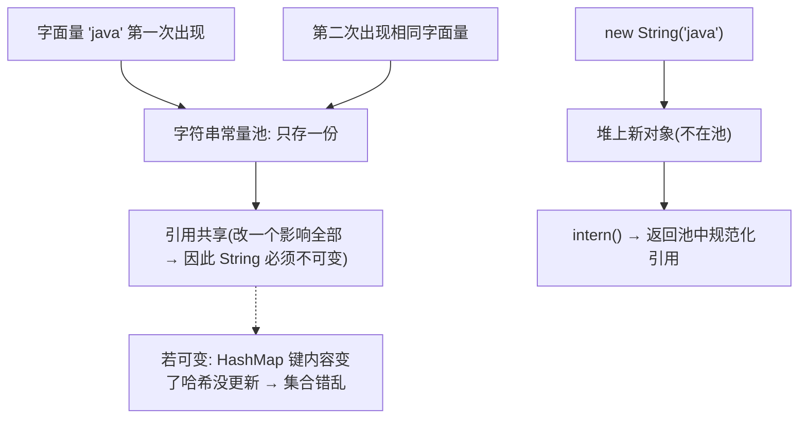

# String、StringBuilder、StringBuffer：不可变、常量池与拼接代价

## 1. 学习目标

- 理解 `String` 是 **`final` 不可变类**：任何「修改」都返回**新对象**，原对象不变。
- 理解 **字符串常量池（String Pool）** 与 `intern()`：相同字面量在池中只存一份，`intern()` 返回池中的规范化引用。
- 讲清 `==`（引用比较）与 `equals`（内容比较）在 String 上的区别，避免用 `==` 比字符串内容的经典错误。
- 讲清 `+` 拼接与 `StringBuilder`/`StringBuffer` 的代价：单条语句的 `+` 编译器会优化为一个 `StringBuilder`；**循环里的 `+` 每轮都 new 一个 `StringBuilder`（O(n²) 级 churn）**；`StringBuilder` 非线程安全、`StringBuffer` 方法 `synchronized`（遗留）。

## 2. 问题动机

字符串是 Java 里最频繁使用的对象。如果 `String` 可变，会带来两个大问题：① 常量池无法安全共享（改一个影响所有引用它的地方）；② 作为 `HashMap` 键时内容变了但哈希没更新，集合会错乱。因此 Java 把 `String` 设计为**不可变 + 常量池共享**。

但不可变意味着每次「拼接/替换」都产生新对象，频繁拼接会制造大量中间对象、拖慢 GC。于是提供 **`StringBuilder`**（单线程高效、非同步）与 **`StringBuffer`**（方法同步，线程安全但慢，现已基本被 `StringBuilder` 取代）。

## 3. 直观理解（类比）

`String` 像刻在**石头上的字**：改内容不是擦掉重写，而是另刻一块新石头，旧的还在。常量池像**公共布告栏**：写 `"hello"` 时先看栏上有没有，有就直接指向它，省料。`StringBuilder` 像**可擦写的草稿纸**：在纸上改字不换纸，最后定稿再刻石头（toString 成 String）。

## 4. 专业术语

- **不可变（immutable）**：`String` 类 `final`、内部存储 `private final`（JDK 9+ 为 `byte[] value + byte coder`），无修改内部状态的方法。
- **字符串常量池 / String Pool**：堆内（JDK 7+ 在堆）的全局缓存，字面量与 `intern()` 结果在此共享。
- **intern()**：返回字符串在常量池中的**规范化（canonical）**引用；若池中已有相等内容则返回那个，否则放入并返回。
- **coder（JDK 9+ compact strings）**：`LATIN1`(单字节) / `UTF16`，按内容选更省的编码。
- **StringBuilder / StringBuffer**：可变字符序列；后者方法 `synchronized`。

## 5. 知识结构地图

```text
字面量 "abc" ──▶ 编译期入池(或从池取) ──▶ 多个变量可共享同一池对象
new String("abc") ──▶ 堆上新对象(内容同池)──▶ 与字面量 == 为 false, equals 为 true
s.intern() ──▶ 返回池中规范化引用(== 可能 true)
拼接:
  单语句 "a"+"b"+"c" ──javac──▶ 一个 StringBuilder.append().toString() (O(n))
  循环内 s += x   ──▶ 每轮 new StringBuilder (O(n²) churn) ❌
可变: StringBuilder.append (非同步, 快) | StringBuffer.append (synchronized, 慢)
```

- **前置**：[equals/hashCode 契约](equals-hashcode.md)（String 的 `equals` 比内容、`==` 比引用）、final 与不可变对象（规划中）。
- **后续关联**：JVM 字符串与常量池/GC（规划中）（M04 规划）、泛型与类型擦除（规划中）。

## 6. 核心技术原理

- **不可变保证**：`String` 为 `final` 类，内部 `value` 私有且 `final`（JDK 8 是 `char[]`、JDK 9+ 是 `byte[]`），所有 `substring/concat/replace/toUpperCase` 都返回**新建**的 `String`，不修改自身。
- **常量池**：编译期字面量进入常量池（class 文件的 `CONSTANT_String_info`，运行期 `ldc` 解析时入池）；`new String("x")` 仍会在堆 new 一个对象，只是其内容与池共享。
- **`==` vs `equals`**：`==` 比引用地址，`equals` 比字符序列。永远用 `equals` 比字符串内容；`s1.intern() == s2.intern()` 在内容相等时可为 `true`（都指向池中同一对象）。
- **拼接代价**：`javac` 对**同一表达式内**的 `+`（如 `"a"+b+"c"`）优化为单个 `StringBuilder`；但**循环**中 `s = s + x` 每轮都是「new StringBuilder(s).append(x).toString() → 新 String」，产生 O(n) 个中间对象，整体 O(n²) 级开销。
- **StringBuilder vs StringBuffer**：`StringBuilder`（JDK 5 引入）方法**未同步**、单线程首选；`StringBuffer` 方法带 `synchronized`，线程安全但无必要场景就是性能浪费。

> ⚠️ 「JDK 9 compact strings（byte[] + coder）」与「JDK 7 起常量池在堆」是版本事实；本章以 **OpenJDK 17** 为准。

## 7. 源码与底层实现（基于 OpenJDK 17 公开行为）

- 字段：`private final byte[] value; private final byte coder;`（JDK 9+）；`coder` 为 `LATIN1` 或 `UTF16`。
- `equals`：先比引用，再比两串 `coder` 是否一致，再逐字节/双字节比较 `value`。
- `concat` / `replace`：构造新的 `byte[]` 并 `new String(...)`，原 `value` 不被改动。
- `intern`：native 方法，调用运行时字符串表（StringTable）的规范化逻辑。

> ⚠️ 字段名与 `equals` 比较逻辑依据 OpenJDK 17 源码结构描述；验证工程通过**可观察行为**（不可变、`intern` 引用共享、`==`/`equals` 差异、拼接结果）佐证，未逐行引用行号。

## 8. 完整执行流程

```text
String a = "abc";            // 入池，a 指向池中 "abc"
String b = "abc";            // b 也指向池中同一对象 → a == b 为 true
String c = new String("abc");// 堆上新对象 → c == a 为 false, c.equals(a) true
String d = c.intern();       // d 指向池中 "abc" → d == a 为 true

循环拼接(反例):
  String s = "";
  for (int i=0;i<n;i++) s += i;   // 每轮: new StringBuilder(s).append(i).toString()
                                    // 产生 n 个中间 String，O(n²) 级对象创建
修正:
  StringBuilder sb = new StringBuilder();
  for (int i=0;i<n;i++) sb.append(i);  // 复用同一可变缓冲区，O(n)
  String s = sb.toString();
```

## 9. 企业业务需求

- **配置/枚举/键值**：大量相等字符串字面量共享池，省内存。
- **SQL/JSON 拼接**：日志、动态 SQL、报文组装若在循环里用 `+` 会制造海量临时对象；统一用 `StringBuilder`/`StringJoiner`。
- **缓存键/Map 键**：依赖 `String` 不可变才能安全作为 `HashMap` 键；可变键是经典 bug。
- **线程安全字符串缓冲**：遗留并发场景用 `StringBuffer`，但现代代码多用局部 `StringBuilder`（局部变量本就线程封闭）。

## 10. Spring Boot 项目架构

Spring Boot 应用里字符串拼接集中在日志、SQL（MyBatis `${}`/`<foreach>`）、JSON 序列化。建议：SQL 用预编译 `?` 参数（不拼接）、日志用占位符 `log.info("id={}", id)`（延迟拼接），避免循环内 `+`。常量字符串尽量用字面量或 `static final String` 享元。

```java
Service: static final String TOPIC = "order.created";  // 字面量入池共享
         log.info("handle {}", TOPIC);                  // 延迟拼接
```

## 11. 完整代码与验证

```java
String a = "abc";
String b = "abc";
String c = new String("abc");
assert a == b;            // 池共享，true
assert a != c;            // 新对象，false
assert a.equals(c);       // 内容相等，true
assert c.intern() == a;   // intern 回池，true

// 不可变验证
String s = "hello";
String u = s.toUpperCase();
assert s.equals("hello");      // 原串不变
assert u.equals("HELLO");      // 返回新串

// 正确拼接
StringBuilder sb = new StringBuilder();
for (int i = 0; i < 3; i++) sb.append(i);
assert sb.toString().equals("012");
```text

## 12. 环境运行与验证

- 工程：`examples/string-verify/`，环境 **OpenJDK 17.0.14 + Maven 3.8.3**，依赖 `junit-jupiter` + `assertj-core`。
- 复现命令：

```bash
cd examples/string-verify && mvn -q test
```

- 预期结果：`Tests run: 9, Failures: 0, Errors: 0, BUILD SUCCESS`（断言：字面量池共享 `a==b`、`new String` 与字面量 `!=` 但 `equals`、`intern()` 回池、`toUpperCase` 不改原串、循环用 StringBuilder 结果正确、`StringBuffer` 也可正确拼接）。

## 13. 企业工程分析

- **永远用 `equals` 比字符串内容**，绝不用 `==`（除非明确在比池引用/枚举式共享）；这是最高频线上 bug 之一。
- **拼接选对工具**：单条语句 `+` 编译器已优化，无需手写 `StringBuilder`；循环/多次拼接必须 `StringBuilder`；`StringJoiner` 适合按分隔符拼接集合。
- **`StringBuffer` 基本退休**：现代服务里字符串构建多在局部变量中（线程封闭），`StringBuilder` 足矣；盲目用 `StringBuffer` 只增 synchronized 开销。
- **不可变 = 安全键**：把 `String` 当 `HashMap`/`ConcurrentHashMap` 键或缓存键是安全的，前提是**不依赖会被外界改动的可变对象**去构造它。

## 14. 技术对比与选型

| 方式 | 可变 | 线程安全 | 适用 |
|---|---|---|---|
| String | 否（每次新对象） | 天然（不可变） | 字面量、键、不频繁改动 |
| StringBuilder | 是 | 否（非同步） | 单线程/局部变量拼接（首选） |
| StringBuffer | 是 | 是（synchronized） | 遗留并发拼接（基本不用） |
| StringJoiner | 是 | 否 | 集合按分隔符拼接 |

## 15. 常见错误与反例

- **用 `==` 比字符串内容** → 多数时候 `false`（除非恰好池共享），应该用 `equals`；更严谨可用 `Objects.equals`。
- **循环里 `s += x`** → O(n²) 级临时对象；应 `StringBuilder`。
- **以为 `toUpperCase/substring` 改了原串** → 返回新串，原串不变，若未接住返回值等于没改。
- **盲目用 `StringBuffer`** → 多付同步成本；局部变量用 `StringBuilder`。
- **依赖 `intern()` 做去重缓存** → 池会一直持有引用（直到 GC 元空间/堆约束），大量动态字符串 intern 有内存风险；去重请用 `ConcurrentHashMap` 等。

## 16. 标准面试回答（话术）

> String 是 final 不可变类，内部 value 私有 final（JDK9+ 是 byte[]+coder），任何修改方法都返回新对象。这样它才能安全进常量池共享、作为 HashMap 键。比较内容永远用 equals，== 比的是引用。拼接方面，单条语句的 + 编译器会优化成 StringBuilder；但循环里的 += 每轮都 new 一个 StringBuilder，是性能坑，要用 StringBuilder。StringBuffer 和 StringBuilder 唯一区别是前者方法 synchronized、线程安全但慢，现在基本用 StringBuilder。

## 17. 高频追问与主动回忆

- 为什么 String 设计成不可变？（常量池共享安全、可作 Map 键、线程安全）
- `new String("abc") == "abc"` 是 true 吗？（false：前者堆新对象，后者池引用；但 `.equals` 为 true）
- `intern()` 返回什么？（池中规范化引用；内容相等则同引用）
- 循环拼接为什么慢？（每轮 new StringBuilder → 多个中间 String，O(n²)）
- JDK 9 对 String 做了什么优化？（compact strings：byte[] + coder，Latin1 省一半内存）

## 18. 五层总结

1. **是什么**：`final` 不可变字符序列 + 常量池共享 + 可变拼接器。
2. **为什么**：不可变保证池共享安全、可作键、天然线程安全。
3. **怎么做**：改内容返回新对象；`==` 比引用、`equals` 比内容；循环用 `StringBuilder`。
4. **约束边界**：不可变带来拼接对象开销；`intern` 有池内存风险；`StringBuffer` 同步已过时。
5. **怎么用**：字面量/键用 String，拼接用 StringBuilder，内容比较用 equals。

## 19. 知识关联

- → [equals/hashCode 契约](equals-hashcode.md)：String 的 `equals` 比内容、`==` 比引用；不可变才能安全作 Map 键。
- → final 与不可变对象（规划中）：不可变设计的「final 字段 + 不暴露可变引用」范式。
- → JVM 字符串与常量池/GC（规划中）（M04 规划）：池的实现位置与回收。

## 20. 事实标记

- ✅ **已执行**：`examples/string-verify` 验证工程（9/9），断言覆盖池共享、`new String` 与字面量引用差异、`intern` 回池、不可变（`toUpperCase` 不改原串）、循环 StringBuilder 正确性、`StringBuffer` 拼接。
- 📄 **源文档陈述**：`final` 类、`byte[] value + byte coder`（JDK9+）、`equals` 比较逻辑、`intern` 为 native 规范化来自 OpenJDK 17 源码结构描述与官方文档。
- ⚠️ **未验证**：未逐行引用 OpenJDK 源码行号；`StringTable` 内部实现与 GC 行为未实测；`StringBuffer` 的同步开销未做基准对比。

## 不可变与常量池（V18 复核增补）



锚点（本章）：`String` 为 `final` 不可变类，任何"修改"返回新对象；相同字面量池中只存一份，`intern()` 返回池引用。
