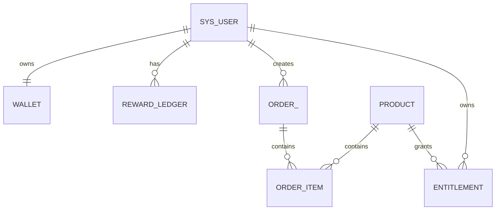

# Architecture-2 · Data Model（数据模型设计）

> 遵循项目规范：表必备 `id BIGINT 自增` + `create_time/update_time` + `deleted INT DEFAULT 0`；
> 逻辑外键、列建索引；H2 与 MySQL schema 同步；金额用 INTEGER（Coin 无小数，§79）。
> **只新增 MVP 必需的 6 张表**（§74-75 必要性评级）。

## 一、必要性评级

| 表 | 评级 | 说明 |
| --- | --- | --- |
| wallet | **P0 新增** | 余额（xp/coin/level）唯一状态 |
| reward_ledger | **P0 新增** | 流水（append-only 可审计） |
| product | **P0 新增** | 商品（价格服务端唯一可信） |
| order / order_item | **P0 新增** | 订单（保留价格快照，未来接真实支付） |
| entitlement | **P0 新增** | 购买资格 |
| reward_rule | P1（可静态） | MVP 用枚举/配置，暂不入库（§20） |
| user_app | 已有（前端 localStorage） | MVP 不动；未来按 §108 加表 |

## 二、表结构（DDL 草案，遵循现有命名）

```sql
-- 1) 钱包：当前状态（Wallet = 当前状态，Ledger = 历史事实，§26）
CREATE TABLE IF NOT EXISTS wallet (
    id BIGINT AUTO_INCREMENT PRIMARY KEY,
    user_id BIGINT NOT NULL COMMENT '用户ID（逻辑外键 sys_user.id）',
    xp INT DEFAULT 0 COMMENT '经验值（成长，不可购买）',
    coin INT DEFAULT 0 COMMENT '金币（平台内消费积分，不可提现/转账）',
    level INT DEFAULT 1 COMMENT '等级（由 LevelService 按 xp 计算）',
    create_time TIMESTAMP DEFAULT CURRENT_TIMESTAMP,
    update_time TIMESTAMP DEFAULT CURRENT_TIMESTAMP,
    deleted INT DEFAULT 0,
    CONSTRAINT uk_wallet_user UNIQUE (user_id)   -- 一人一个钱包
);
CREATE INDEX idx_wallet_user ON wallet(user_id);

-- 2) 流水：历史事实（Append Only，§23；错误用补偿流水，不 UPDATE）
CREATE TABLE IF NOT EXISTS reward_ledger (
    id BIGINT AUTO_INCREMENT PRIMARY KEY,
    user_id BIGINT NOT NULL COMMENT '用户ID',
    currency VARCHAR(8) NOT NULL COMMENT '币种：XP / COIN',
    amount INT NOT NULL COMMENT '变动金额（正=收入，负=支出）',
    direction VARCHAR(8) NOT NULL COMMENT 'CREDIT / DEBIT',
    reason VARCHAR(50) NOT NULL COMMENT '原因：CHAPTER_COMPLETE / PURCHASE_APP / CHECK_IN / ACHIEVEMENT_UNLOCK ...',
    source_type VARCHAR(40) COMMENT '来源：EVENT / PURCHASE / COMPENSATION',
    source_id BIGINT COMMENT '来源事件或订单ID',
    balance_after INT NOT NULL COMMENT '变动后余额（审计快照）',
    create_time TIMESTAMP DEFAULT CURRENT_TIMESTAMP,
    deleted INT DEFAULT 0
);
CREATE INDEX idx_ledger_user_time ON reward_ledger(user_id, create_time);
CREATE INDEX idx_ledger_source ON reward_ledger(source_type, source_id);

-- 3) 商品（App 与 Product 分离：App=能力，Product=商品，§34）
CREATE TABLE IF NOT EXISTS product (
    id BIGINT AUTO_INCREMENT PRIMARY KEY,
    product_key VARCHAR(50) NOT NULL COMMENT '商品唯一键',
    name VARCHAR(100) NOT NULL COMMENT '商品名（如 Feynman Pro）',
    description VARCHAR(500),
    type VARCHAR(20) NOT NULL COMMENT '类型：APP / AI_CAPABILITY / CONTENT（MVP 只做 APP）',
    app_key VARCHAR(50) COMMENT '关联 AppDefinition.key（Architecture-1）',
    price_coin INT NOT NULL COMMENT '价格（Coin，服务端唯一可信，§38/§103）',
    status VARCHAR(20) DEFAULT 'ACTIVE' COMMENT 'ACTIVE / DISABLED',
    version VARCHAR(20) DEFAULT '1.0.0',
    create_time TIMESTAMP DEFAULT CURRENT_TIMESTAMP,
    update_time TIMESTAMP DEFAULT CURRENT_TIMESTAMP,
    deleted INT DEFAULT 0,
    CONSTRAINT uk_product_key UNIQUE (product_key)
);

-- 4) 订单（保留购买时价格快照，§43/§80）
CREATE TABLE IF NOT EXISTS order_ (
    id BIGINT AUTO_INCREMENT PRIMARY KEY,
    order_no VARCHAR(40) NOT NULL COMMENT '订单号（唯一）',
    user_id BIGINT NOT NULL,
    total_coin INT NOT NULL COMMENT '订单总额（Coin）',
    status VARCHAR(20) NOT NULL COMMENT 'PENDING / PAID / FAILED / REFUNDED',
    create_time TIMESTAMP DEFAULT CURRENT_TIMESTAMP,
    update_time TIMESTAMP DEFAULT CURRENT_TIMESTAMP,
    deleted INT DEFAULT 0,
    CONSTRAINT uk_order_no UNIQUE (order_no)
);
CREATE TABLE IF NOT EXISTS order_item (
    id BIGINT AUTO_INCREMENT PRIMARY KEY,
    order_id BIGINT NOT NULL COMMENT '逻辑外键 order_.id',
    product_id BIGINT NOT NULL,
    product_key VARCHAR(50) NOT NULL,
    product_name VARCHAR(100) NOT NULL,
    price_coin INT NOT NULL COMMENT '购买时价格快照（不读 product 现值解释历史订单，§43）',
    create_time TIMESTAMP DEFAULT CURRENT_TIMESTAMP,
    deleted INT DEFAULT 0
);
CREATE INDEX idx_order_item_order ON order_item(order_id);

-- 5) 资格（Entitlement = 拥有资格；UserApp = 应用启用状态，§45）
CREATE TABLE IF NOT EXISTS entitlement (
    id BIGINT AUTO_INCREMENT PRIMARY KEY,
    user_id BIGINT NOT NULL,
    product_id BIGINT NOT NULL,
    product_key VARCHAR(50) NOT NULL,
    status VARCHAR(20) DEFAULT 'ACTIVE' COMMENT 'ACTIVE / REVOKED',
    granted_at TIMESTAMP DEFAULT CURRENT_TIMESTAMP,
    create_time TIMESTAMP DEFAULT CURRENT_TIMESTAMP,
    deleted INT DEFAULT 0,
    CONSTRAINT uk_entitlement_user_product UNIQUE (user_id, product_id)
);
CREATE INDEX idx_entitlement_user ON entitlement(user_id);
```

## 三、关系图（Mermaid ER）



## 四、生命周期

| 表 | 创建 | 更新 | 删除 |
| --- | --- | --- | --- |
| wallet | 用户注册时（幂等） | 仅 RewardEngine / PurchaseService 事务内 | 逻辑删除随账号 |
| reward_ledger | 每笔入账/支出 | 永不更新（append-only） | 不删（审计） |
| product | 种子/管理端 | 管理端 | 逻辑删除（DISABLED 优于删） |
| order / order_item | 购买事务 | 状态流转 | 不删 |
| entitlement | 购买事务 | REVOKED（极端） | 不删（保留资格史） |

## 五、并发与一致性（§28/§105）

- **购买扣款**：`UPDATE wallet SET coin = coin - ? WHERE user_id = ? AND coin >= ?`（条件更新，返回行数=1 才成功）→ 防止并发超扣。
- **奖励入账**：`reward_ledger` 唯一键（user_id, source_type, source_id, currency）+ `INSERT ... ON DUPLICATE`/先查后插 → 幂等。
- 事务边界：购买 = 1 个 `@Transactional`（扣 coin + order + order_item + entitlement + userApp 全在一个事务，§40）；奖励 = 1 个事务（ledger + wallet）。
