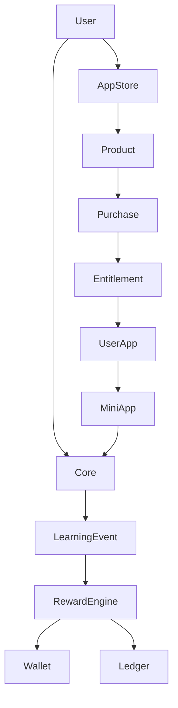
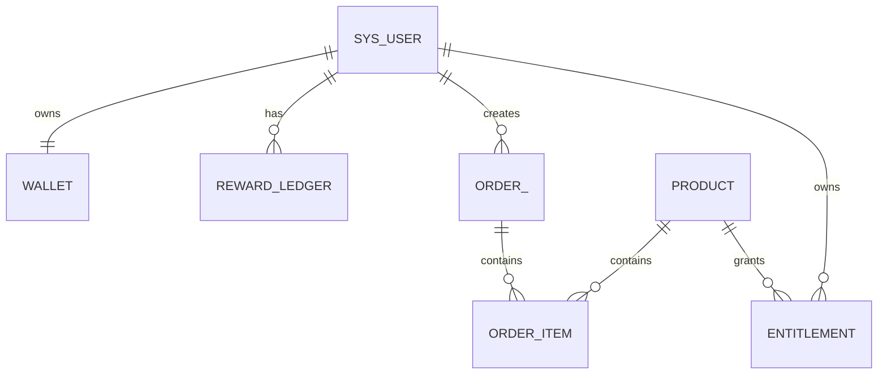

# Architecture-2 · 总报告（Learning Economy + App Store）

> 基于全项目真实源码扫描（backend/src/main/java、resources/db/h2/schema.sql、frontend/src，2026-08-30）。
> 本阶段为**架构分析报告**：零业务代码改动、零数据库改动、零 API 改动（§196）。前端 build ✓ / vue-tsc 74 基线 / 后端 test-compile ✓。

## 1-10. 当前产品架构（现状）

- **CORE（既有）**：identity（sys_user/JWT）、knowledge（doc/category/favorite）、learning（path/chapter/task/plan）、**event（learning_event 20 种事件，真实）**、mastery（knowledge_mastery）、review（SrsService 唯一）、ai（chat/agent/rag）。
- **Mini Apps（Architecture-1 已建）**：前端静态 Registry（`src/apps/registry.ts`，13 个内置 App，route 全部真实）+ `stores/apps.ts`（localStorage 用户状态）+ `/apps` App Center。
- **LearningEvent**：`record(userId, type, resourceType, resourceId, metadata)` 真实存在；各事件调用点已验证（QUESTION_ANSWERED×4 / MISTAKE×4 / FLASHCARD_REVIEWED×3 …）。
- **Mastery / SRS / Quiz / Flashcard**：Phase 0/1 已收敛，本阶段**全部只读消费，不重建**（§156-161）。
- **Reward 现状**：`sys_user.exp/level/energy` 存在；真实入账仅两处（achievement 解锁、code_challenge 过关）；打卡 reward_exp/reward_energy 只进 `user_check_in` **未入账**；`/user/stats` 用**推导公式**（readDocs×10+paths×50+fav×5）——**与 sys_user.exp 口径分裂（G1）**。
- **App Registry**：前端静态（Architecture-1）；无后端 user_app 表。
- **Database**：H2=MySQL 同构，77 张表；**无 wallet/ledger/product/order/entitlement/user_app**。
- **API**：无钱包/商店 API；打卡/成就/挑战 API 真实。
- **重复模型**：无第二套积分；但有「exp 两口径」（入账 vs 推导）；无重复 App 平台。

## 11-25. 目标架构（设计）

- **Core**：同上（基本不动）。
- **Mini Apps**：13 个，复用 Architecture-1。
- **Reward**：XP（成长，不可购买）+ Coin（平台内消费，不可提现/转账，§8）；Wallet = 当前状态，Ledger = 历史事实（§26）。
- **RewardEngine**：唯一发奖入口，输入=LearningEvent，规则=静态枚举（MVP，§20），append-only Ledger（§23），幂等=唯一键（§29）。
- **Product**（App=能力 / Product=商品 分离，§34）：只给真实 App 建 ≤5 个收费商品，默认 4 App 免费（§49）。
- **Order**：保留价格快照，为未来真实支付预留（§42-43/§108）。
- **Entitlement**：拥有资格，与 UserApp（启用状态）分离（§45）。
- **UserApp**：MVP 复用前端 localStorage（§23）；未来后端化（§108）。
- **Purchase**：单事务（扣 Coin + Order + Entitlement + UserApp），条件扣款防并发（§28/§40/§105）。

## 26-32. 横切设计

- **Security**：SecurityContext 取 userId；只查自己的数据；价格/奖励金额后端唯一可信；enabled≠权限（§87）。
- **Idempotency**：ledger 唯一键（user_id, source_type, source_id, currency）。
- **Concurrency**：条件更新 `coin >= ?`；单库单事务（Modular Monolith，§107）。
- **Database**：新增 6 表（wallet/reward_ledger/product/order/order_item/entitlement），H2+MySQL 同步，金额 INTEGER。
- **API**：`GET /wallet`、`GET /wallet/ledger`、`GET /store/products`、`GET /store/owned`、`POST /store/purchase`（5 个最小集）。
- **Frontend**：`src/economy/` + `stores/wallet.ts` + WalletPage + AppCenter 精选区；UI 走克制专业语言（§124）。
- **Backend**：新增 `com.knowflow.reward` 与 `com.knowflow.store` 两个模块，沿用 Controller→Service→Mapper 分层（§189）。

## 33-37. Migration / MVP / Future / Risks / Phases

- **Migration**：叠加式，无需删字段；老用户 wallet 惰性初始化（xp=sys_user.exp）；stats 字段名不变只换数据源；无旧 Coin 数据可迁（§191）。
- **MVP（§184）**：XP + Coin + Wallet + RewardLedger + RewardEngine + App Store(Product/Order/Entitlement) + UserApp(复用) + 学习→奖励 + 购买→Coin→App。
- **MVP 不含（§185）**：支付/充值/提现/转账/抽奖/排行榜/第三方开发者/Token Billing/游戏。
- **Future（§108-113 仅预留）**：真实支付、订阅、AI Token Billing、小游戏、第三方开发者平台、App Review/Revenue Share。
- **Risks**：详见 `Architecture-2-Risk-Matrix.md`（P0：幂等/并发/口径；P1：Store/越权/回归）。
- **Phases**：2.1-2.10，详见 `Architecture-2-Implementation-Phases.md`。

## 38. 最终推荐（Final Recommendation）

### ✅ 现在必须做（P0，下一步实施指令）
1. **统一口径**：新增 wallet，`/user/stats` 改读 wallet（修 G1）；打卡事件入账（修 G2/G7）。
2. **Reward 地基**：wallet + reward_ledger + RewardRule(枚举) + RewardEngine。
3. **Store 最小闭环**：product + order/order_item + entitlement + `POST /store/purchase`（事务+条件扣款）。

### ⏸ 暂时不要做（P1，MVP 之后）
- user_app 后端化（跨设备）、前端 Wallet 页美化、成就/挑战入账统一入口、Level 公式配置化。

### 🕐 以后再做（预留）
- 真实支付、订阅、AI Token Billing、小游戏、第三方开发者平台、排行榜/评分（文档已预留边界）。

## 最终技术架构图

## 最终 ER 图

---

**本阶段完成，已停止。** 未修改任何业务代码/数据库/API，未 commit/push。等待下一条指令（建议从 Architecture-2.1 开始实施）。
