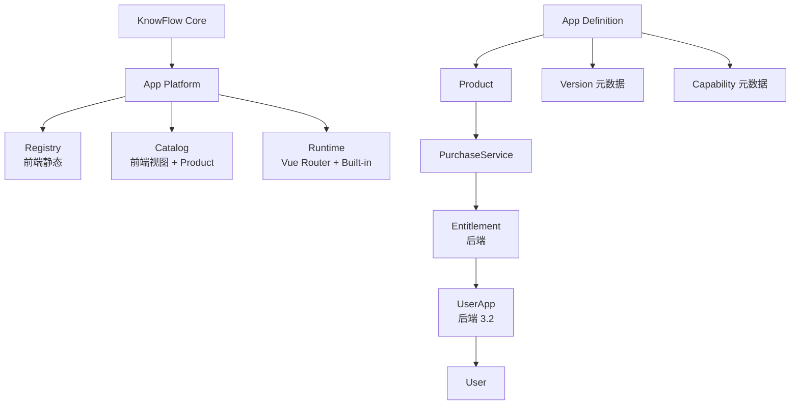

# Architecture-3 · 总报告（App Store / Mini App Platform 2.0）

> 基于真实源码核验（Architecture-1/2 产物 + 全仓库扫描，2026-08-30）。**本阶段仅设计，零代码改动。**
> 验证：前端 vite build ✓ / vue-tsc 74 基线 / 后端 test-compile ✓（与上阶段一致，未改代码）。

## 1. 现状 → 目标 → 差距

| 维度 | 现状 | 目标 | 差距 |
| --- | --- | --- | --- |
| App Definition | 静态 Manifest 雏形（11 字段 + capabilities） | AppManifest（元数据） | 基本达成，仅需状态收敛 |
| Registry | 前端静态（13 App） | 运行时能力注册 | 保持（Built-in 无需后端化） |
| Catalog | AppCenter + ProductService | 应用目录（发现/分类/精选） | 前端视图层待整理（3.3） |
| Product | 5 付费商品 + 4 免费 | 商品目录 | 已达标，复查通过 |
| Entitlement | 后端表（服务端真源） | 不变 | 已达标 |
| **UserApp** | **localStorage** | **后端 user_app** | **核心差距（3.2，P1）** |
| App Version | AppDefinition.version='1.0.0' | 版本元数据 | 已达标（表/API 均为 Future） |
| App Capability | 元数据声明 | 元数据（无沙箱） | 已达标，待对齐清单 |
| APP_DISABLED 门禁 | 未实现（Architecture-2 遗留） | 后端可判断 App 可用性 | **UserApp 后端化后解决** |
| 第三方平台 | 无 | 仅架构预留 | Future |

## 2. 平台模型（§280）

```
                KnowFlow Core
                     │
                App Platform
                     │
        ┌────────────┼────────────┐
        ↓            ↓            ↓
     Registry      Catalog      Runtime
        │            │            │
        └────────────┼────────────┘
                     ↓
                    App
                     │
           ┌─────────┼─────────┐
           ↓         ↓         ↓
        Product   Version   Capability
           │
        Purchase
           ↓
      Entitlement
           ↓
        UserApp
           ↓
        User
```

## 3. 数据库评级（§210/§285，真实结论）

| 表 | 评级 | 依据 |
| --- | --- | --- |
| user_app | **P1（3.2 新增）** | 跨设备同步 + APP_DISABLED 门禁（§35/§47） |
| app_definition | 静态（不入库，§212） | 前端 Registry 已足够（Built-in） |
| app_version | Future（§213） | version 元数据在 AppDefinition |
| app_listing | 不入库（§214） | Registry + Product 已覆盖 |
| app_publisher | Future（§215） | 无第三方 |
| app_review | Future（§216） | 无审核系统 |

## 4. API Matrix（§286）

| API | 当前 | Architecture-3 | 是否新增 |
| --- | --- | --- | --- |
| GET /api/store/products | ✅ | 复用 | 否 |
| GET /api/store/products/{id} | ✅ | 复用 | 否 |
| GET /api/store/owned | ✅ | 复用 | 否 |
| POST /api/store/purchase | ✅ | 复用 | 否 |
| GET /api/wallet、/wallet/ledger | ✅ | 复用 | 否 |
| GET /api/apps/user-apps | ❌ | 3.2 | **是（最小集）** |
| PUT /api/apps/user-apps/{appKey} | ❌ | 3.2 | **是（最小集）** |
| /apps/all、/apps/catalog、/apps/store | ❌ | ❌ 禁止新增（§219） | 否 |

## 5. Frontend Matrix（§287）

| 文件 | 当前职责 | 新职责（3.x） | 修改 |
| --- | --- | --- | --- |
| src/apps/types.ts | AppDefinition/UserAppState/MiniAppContext | Manifest 收敛（3.1） | 微调 |
| src/apps/registry.ts | 13 App 静态注册 | capabilities 对齐（3.5） | 微调 |
| src/stores/apps.ts | localStorage 真源 | API→Pinia→cache（3.2） | **重构** |
| src/views/AppCenterPage.vue | 我的应用/全部/付费精选 | Catalog 视图整理（3.3） | 中改 |
| src/views/WalletPage.vue | 钱包 | 不变 | 否 |
| src/economy/* | 类型/常量 | 复用 | 否 |

## 6. Backend Matrix（§288）

| Package | 当前 | 新职责（3.2） | 修改 |
| --- | --- | --- | --- |
| com.knowflow.reward | 奖励引擎 | 不变 | 否 |
| com.knowflow.store | 商品/购买/资格 | 不变（PurchaseService/EntitlementService 唯一入口，§199-201） | 否 |
| com.knowflow.apps（新增） | — | UserAppService + AppsController | **新增（3.2）** |
| entity/mapper | 6 经济实体 | +UserApp | +1 |

## 7. Security Matrix（§289/§293）

| 对象 | 可信来源 | 第一版状态 |
| --- | --- | --- |
| App Key | 前端本地 Registry 白名单 | ✅（静态天然白名单） |
| Route | 前端已知本地路由 | ✅（route 全静态，禁止远程执行 §234） |
| Capability | 元数据（不构成权限） | ✅ |
| Product 价格 | 后端 product 表 | ✅（Architecture-2） |
| Entitlement | 后端 entitlement 表 | ✅ |
| UserApp | 后端 user_app（3.2 后） | ⏳ 3.2 落地；localStorage 仅缓存（§243） |
| App 可用性 | 后端（3.2 后） | ⏳ 解决 APP_DISABLED（§48） |

## 8. 迁移方案（§290-292）

localStorage UserApp → 后端 user_app：首次登录上传合并（服务端优先；无服务端记录用本地）；localStorage 降级缓存；上线失败回退本地兜底，不丢状态。详见 `Architecture-3-UserApp-Migration.md`。

## 9. MVP / V2 / Future（§282）

| 层级 | 内容 |
| --- | --- |
| **MVP（Architecture-3.1~3.5）** | Registry 收敛 / **UserApp 后端化** / Catalog UI / Version 元数据 / Capability 元数据 / APP_DISABLED 门禁 |
| **V2** | 多商品（App 1:N Product）、App 详情页（权限/版本/更新说明）、离线增强 |
| **Future** | Developer 平台 / App Review / Signed Package+Sandbox / 真实支付 / 小游戏 Runtime / AI Token Billing / 分成（§295 全部不实施） |

## 10. 最终推荐

**先做 Architecture-3.2（UserApp 后端化）**——它同时解决两个真实诉求：跨设备同步 + APP_DISABLED 后端门禁（Architecture-2 遗留 BLOCKER）。其余（Catalog UI、Version/Capability 元数据）为低成本增量。**不新增任何「平台感」多余表/API**（§217-219）。

## 11. 不做什么（§295/§312）

动态 JS / 代码下载 / 第三方 Runtime / 沙箱 / 真实支付 / 充值 / 提现 / 转账 / 开发者平台 / App 审核 / 分成 / 排行榜 / 评分 / 评论 / 游戏 Runtime / Token Billing —— 全部不实施。

## 12. 遗留问题分类（§299）

- BLOCKER：APP_DISABLED 后端门禁（3.2 解决）。
- NON-BLOCKER：经济闭环实机验证、Reward Toast、74 历史 TS 错误。
- FUTURE：每日上限粒度、版本商店、第三方平台。

## 13. 技术架构图（最终）


