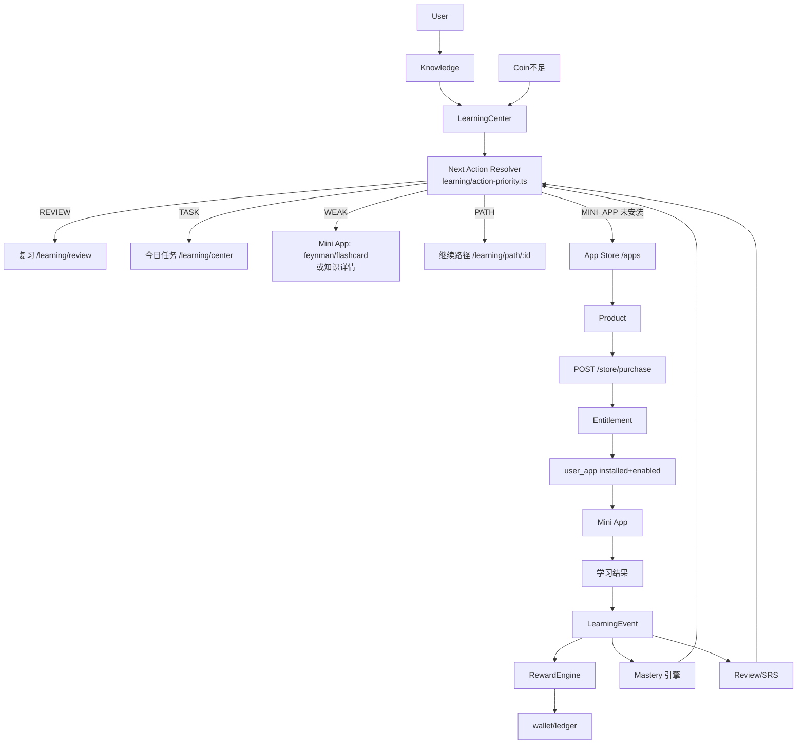

# Architecture-4 · Workflow Design（Learning Workflow 设计）

> 日期：2026-08-30。配套：《Architecture-4-Workflow-Current-State.md》（数据盘点）。
> 本文件按 §353 的 15 节结构组织。

---

## 1. 定义

**Learning Workflow**：用户围绕学习目标，通过多个 Mini App 连续完成学习行为，系统持续记录行为（LearningEvent）、更新掌握度（Mastery/Review），并根据当前状态（Review/Task/Weak/Path/App）规则驱动地推荐下一步动作（Next Action），形成「发现能力 → 获取能力 → 使用能力 → 产生学习事实 → 更新掌握度 → 获得奖励 → 推荐下一步」的闭环。

**实现形态**：Workflow 不是数据库实体（§14），是 **Query（复用已有数据）+ Recommendation（规则 Resolver）+ Navigation（白名单路由）** 层。第一版为**前端规则驱动**（§145），后端零改动（§65-67）。

## 2. Data Sources（§15/§18）

| 数据 | 来源 | 说明 |
| --- | --- | --- |
| reviewRequired | `GET /learning/mastery/review-required` | 已进入复习队列 |
| weakPoints | `GET /learning/mastery/weak` | 掌握度低/近期错误多 |
| tasks | `GET /learning/tasks` | 今日任务（status≠1 未完成） |
| currentPath | `GET /learning/paths` | enrolled=true 且 0<progress<100 |
| installedApps | `stores/apps`（后端 user_app 真源） | 已安装且启用 |
| products | `GET /store/products` | 付费商品（appKey→priceCoin/owned） |
| wallet | `GET /wallet` | Coin 余额（购买判定） |

全部来自页面已加载数据或按需单次拉取（§286-289，不 N+1）。

## 3. Next Action（§51-53）

```ts
type LearningActionType = 'REVIEW' | 'QUIZ' | 'FLASHCARD' | 'KNOWLEDGE' | 'LEARNING_PATH' | 'TASK' | 'MINI_APP' | 'EXPLORE'

interface NextLearningAction {
  type: LearningActionType
  title: string      // 用户可见
  reason: string     // 真实数据原因（§60-62）
  route: string      // 白名单解析（§82-84）
  appKey?: string    // MINI_APP 时必填（Registry 白名单 §176）
  knowledgeId?: number // 知识点上下文（§115-117）
}
```

## 4. Priority（§54/§131）

```
REVIEW（待复习） > TASK（今日任务） > WEAK（薄弱知识） > PATH（当前路径） > EXPLORE（兜底）
```

薄弱知识内部再按 App 优先级：`feynman（费曼解释）→ flashcard（闪卡巩固）→ 知识详情页`（均需已安装启用，§130）。

## 5. App Integration（§38-49/§96）

- **A 类（有 LearningEvent）**：flashcard / quiz / mistake / memory-palace / coding —— 复用现有事件，不新建 Event 体系（§36-37）；
- **D/C 类（工具型）**：feynman / cornell / knowledge-graph / mindmap / drawing / ai-writing / notes / focus —— 不因「使用/保存/点击」发学习奖励（§40/§47-49/§50）；
- 本阶段 MVP 闭环选择 **flashcard + quiz**（完整度最高，§202）。

## 6. Store Integration（§21-22/§87-92/§163-168）

NextActionCard 对 MINI_APP 动作按状态分流：

| 状态 | 按钮 | 动作 |
| --- | --- | --- |
| 已安装已启用 | [打开] | 直接进入（§164） |
| 已安装停用 | [重新启用] | 启用后进入，无需再购买（§165/§207） |
| 未安装·免费 | [获取] | install 后进入（§89/§308） |
| 未安装·付费·Coin 够 | [兑换 · N Coin] | 跳 `/apps?redeem=<appKey>`，AppCenterPage 完成购买后自动打开（§93/§205） |
| 未安装·付费·Coin 不足 | [去学习赚取] | 回学习中心（§91-92/§126） |
| App 平台停用 | [暂不可用] | 不可购买/不可进入（§166/§208） |

商品未加载完成前禁止直接免费安装付费 App（§306-308）。

## 7. Reward Integration（§109/§138/§194/§198-199）

- Reward 仍由后端 `LearningEvent → RewardEngine` 计算（§142），前端**绝不自行 credit**（§302-305）；
- 新增 `economy/rewardToast.ts`：动作前后各拉一次真实钱包，diff 即真实奖励，轻量 toast 展示「+X XP · +Y Coin」（§109）；
- 闪卡会话按「会话基线 → 会话结束 diff」汇总展示（避免逐卡刷屏）。

## 8. Mastery Integration（§225）

- Mastery 仍为 Core Service（§143），App 不得自建 Mastery（§230）；
- 掌握度变化不伪造前后值（§139-140）：有则展示，无则只提示「掌握度已更新」。

## 9. Review Integration（§55/§225）

- 有 `REVIEW_REQUIRED` 知识点 → Next Action 首位（§54-55）；
- 刚完成 REVIEW 的 30 分钟内不重复推荐（循环保护 §260-264）。

## 10. Context Propagation（§114-117/§236-238）

- 不新建 Context Service（§116/§237），优先 route query + Pinia（§238）；
- Resolver 产出的 `knowledgeId` 透传：KNOWLEDGE 动作 → `/learning/knowledge-mastery/:id`；MINI_APP/FLASHCARD 动作附带 `knowledgeId` query（页面按能力消费，不强求全支持）。

## 11. Routing（§81-86/§160-162）

- `learning/route.ts` 提供**本地白名单**：核心动作固定映射（REVIEW→/learning/review 等），MINI_APP 经静态 `apps/registry.ts` 解析（§85）；
- 禁止任意远程 URL / `javascript:`（§83/§86）；
- `actionToCta()` 让 Home / LearningCenter 主按钮与「下一步」卡片共用同一来源（§69）。

## 12. Security（§306-316）

| 对象 | 真源 | 防护 |
| --- | --- | --- |
| AppKey | 前端 Registry + 后端 OfficialAppRegistry | 未知 key 拒绝（INVALID_APP） |
| Route | 本地白名单 | 禁远程执行 |
| 价格 | 后端 product 表 | 请求体忽略前端价格 |
| Entitlement / UserApp | 后端 | 本地仅缓存 |
| 购买门禁 | PurchaseService isActive | APP_DISABLED 先校验再扣款（Architecture-3） |
| 奖励 | RewardEngine | 幂等键防重复（Architecture-2） |

Workflow 不绕过 Spring Security / Entitlement / UserApp（§306）。

## 13. Fallback（§79/§250/§344-350）

- 数据缺失 → Resolver 按可用数据降级，最终 EXPLORE「继续探索知识」；
- 商品拉取失败 → 按免费处理（安装流程仍可用）；
- 缓存删除 → 状态从后端恢复（Architecture-3 已实现）；
- 不做复杂 Next Action 持久化（§349），不新增 Workflow 状态表（§350）。

## 14. Mobile（§283）

- NextActionCard 在 390px / 768px 下：按钮文字可换行、hint 与按钮 flex-wrap 堆叠；
- Home / LearningCenter 均为响应式栅格（既有 `--kb-*` 令牌体系）。

## 15. Accessibility（§285）

- 卡片为 `<section aria-label="下一步学习建议">`；
- 按钮为语义化 `<button>`，支持键盘焦点（Button 组件 focus-visible ring）；
- 关闭按钮带 `aria-label="关闭建议"`；
- 颜色不承担唯一信息（hint 文字 + 按钮文案同时表达状态）。

---

## 完整系统图（§361，基于真实项目）


