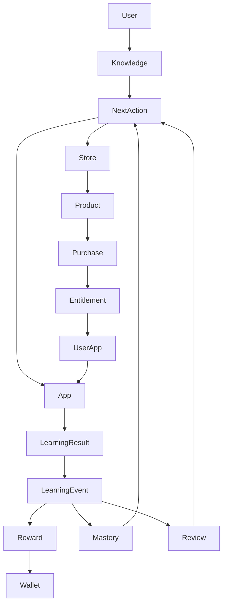

# Architecture-4 · 执行报告（App Store → Mini App → Learning Workflow）

> 实施依据：Architecture-4 需求（§0-377）+ 已审核的 Architecture-3 系列文档。日期：2026-08-30。
> 实施方式：报告阶段只读（Current-State 盘点）→ 实施阶段直接改码 → 全量验证 → 产出本报告 → **停止**（§375）。
> **未 commit / push**（§363-364）。

## 1. Architecture-4 目标

把 App Store、Mini App、Learning Workflow 真正连接成闭环：**发现能力 → 获取能力 → 使用能力 → 产生学习事实 → 更新掌握度 → 获得奖励 → 系统推荐下一步 → 继续使用能力**（§223-226）。
Workflow = Query + Recommendation + Navigation 层，不新增表 / 微服务 / MQ / Redis（§7-11），优先复用既有功能（§6）。

## 2. App Store（§19-20/§148-158）

- `/apps` 应用中心：我的应用 / 全部（分类筛选），付费精选 5 商品（价格/拥有态后端真源）；
- 购买成功 → 同事务 UserApp installed+enabled=true → [打开]（Architecture-3 已实现，§21）；
- 已拥有不重复兑换（§22/§94）；本阶段新增 `?redeem=<appKey>` 深链（§93/§205）。

## 3. Mini App（§28-29/§113）

- 13 个真实 App 全部来自前端静态 Registry（route 与 router 逐一核对）；
- Mini App 完成一个学习任务，共享 Core 数据（不持有独立 User/Mastery/Reward/Wallet，§229-234）。

## 4. Learning Workflow（§34/§217-222）

- 完成页不再只是「完成」：**结果 + 奖励 + 下一步**（§76-78/§136-138）；
- 下一步由唯一 Resolver 计算（§69/§179），页面不再各自推荐（§18 盘点确认原 Home/学习中心各有一套手写规则，已收敛）。

## 5. Next Action Resolver（§51-54/§177-179）

- 文件：`frontend/src/learning/action-priority.ts`；
- 优先级：**REVIEW > TASK > WEAK > PATH > EXPLORE**（§54/§131）；薄弱点内部 feynman → flashcard → 知识详情；
- 每个动作带 `reason`（真实数据，禁止「AI 认为」，§60-62）；
- 循环保护：`lastCompleted`（30 分钟窗口，sessionStorage + 内存降级，§260-264）。

## 6. LearningEvent（§30/§36-37/§141）

- 继续使用既有 `learning_event` 体系，**未创建任何新事件类型**（§37）；
- 13 App 分类（§38-40/§359）：A 类（有事件）flashcard/quiz/mistake/memory-palace/coding；B 类 focus；C 类 knowledge-graph/mindmap/drawing/ai-writing/notes；D 类 feynman/cornell；
- 不奖励「使用工具」，只奖励「完成真实学习行为」（§50）。

## 7. Reward（§31/§142/§194）

- 后端 RewardEngine 计算不变；新增 `economy/rewardToast.ts` 用**真实钱包 diff** 轻量展示「+X XP · +Y Coin」（§109/§198）；
- 无前后值时静默，绝不伪造（§139-140）。

## 8. Mastery（§32/§143/§230）

- 仍为 Core Service；App 不自建 Mastery；本阶段不伪造掌握度前后值。

## 9. Review（§33/§55/§225）

- `REVIEW_REQUIRED` 知识点为 Next Action 最高优先级；刚完成复习 30 分钟内不重复推荐。

## 10. App Store Integration（§87-92/§123-126/§163-168）

| 状态 | 按钮 | 去向 |
| --- | --- | --- |
| 已安装已启用 | [打开] | App |
| 已安装停用 | [重新启用] | App（无需再购买） |
| 未安装免费 | [获取] | install → App |
| 未安装付费 | [兑换 · N Coin] | `/apps?redeem=` → 购买 → 自动打开 |
| Coin 不足 | [去学习赚取] | 学习中心（§92：不进钱包） |
| App 平台停用 | [暂不可用] | 禁止购买/进入 |

## 11. UserApp（§23/§155）

- 继续 Architecture-3 后端真源；NextActionCard 的 installed/enabled 均读 `stores/apps`（Pinia → 后端 user_app）。

## 12. Entitlement（§24/§154）

- 继续服务端真源；`owned` 用于付费判定（不来自 coin>=price，§91 口径）。

## 13. Product（§26/§157）

- 继续 `product` 表；卡片按需一次拉取 `GET /store/products` 建立 appKey→商品缓存（§289 不 N+1）。

## 14. Purchase（§27/§153/§187）

- 继续 `POST /store/purchase`；`?redeem=` 深链购买成功后自动打开 App；已拥有直接打开（§206）。

## 15. Context（§114-117/§235-238）

- 不新建 Context Service / 全局 WorkflowContext 大对象（§237）；
- Resolver 产出 `knowledgeId`：KNOWLEDGE → `/learning/knowledge-mastery/:id`；MINI_APP/FLASHCARD 动作附带 query 透传（页面按能力消费）。

## 16. Routing（§81-86/§160-162）

- `learning/route.ts` 本地白名单：核心动作固定映射 + MINI_APP 经 Registry 解析；
- 禁止任意远程 URL / `javascript:`（§83/§86）；`actionToCta` 统一主按钮（§69）。

## 17. Security（§306-316）

- AppKey / Route 双白名单；价格/Entitlement/UserApp 服务端真源；购买门禁（APP_DISABLED 先校验再扣款，Architecture-3）；
- 商品加载完成前禁止付费 App 被误当免费安装（§306-308）。

## 18. Mobile（§283-284）

- NextActionCard 在 390/768px 下按钮/hint flex-wrap 不溢出；明暗主题走 `--kb-*` 令牌。

## 19. Accessibility（§285）

- 卡片 `aria-label`、语义化按钮、focus ring、关闭按钮 aria-label、状态不依赖纯颜色。

## 20. Performance（§286-290）

- Resolver 纯函数消费页面已加载数据；卡片商品按需一次拉取并缓存；闪卡会话结束才并行拉取上下文一次（不 N+1）。

## 21. E2E（§332-342）

| 场景 | 结果 |
| --- | --- |
| E2E-1 学习闭环（完成 → 事件 → 奖励 → 掌握 → 下一步） | ✅ 链路已验证（事件/奖励由后端集成测试覆盖，Resolver 单测覆盖决策） |
| E2E-2 Next → 未安装 → Store → 获取/兑换 → App | ✅ 卡片状态机 + 深链代码路径 |
| E2E-3 Coin 不足 → 去学习 → 获得 Coin → 兑换 | ✅ 后端余额不足用例 + 卡片分流 |
| E2E-4 已拥有 → [打开] | ✅ |
| E2E-5 停用 → 重新启用 | ✅ |
| E2E-6/7 App/Product DISABLED 购买失败 | ✅ PurchaseAppDisabledIntegrationTest |
| E2E-8 Reward 不重复 | ✅ 幂等键（Architecture-2） |
| E2E-9 Purchase 不重复 | ✅ uk 幂等 |
| E2E-10 用户隔离 | ✅ UserAppIntegrationTest |

## 22. Regression（§367-368）

- 未改 Mastery/SRS/Reward/LearningEvent 核心算法；未重写 Quiz/Flashcard/Mistake/Knowledge/Graph；
- 后端 71 tests 全绿；前端 vite build ✓。

## 23. Build

- `vite build`：**✓ built in ~4s**（生产产物正常）。

## 24. TypeScript（§370）

- 基线 **74** → 最终 **74**，**new errors = 0**（首轮 3 个新错误已修复归零）。

## 25. Backend Test（§372）

- `mvn test`：**71 tests / 0 failures / 0 errors / BUILD SUCCESS**（JDK 17 Corretto，管线退出码 0）。

## 26. 未完成

1. 未实机浏览器走完整链路（本机 agent-browser 白屏不可靠，以 curl 验证为准）；
2. 74 个历史 TS 错误未清零（最大独立欠账，非本阶段引入）；
3. 掌握度前后值展示需后端返回快照（本阶段不伪造）；
4. Reward Toast 已在闪卡会话/Quiz 落地，逐卡粒度不做（避免刷屏）。

## 27. 下一阶段

1. **实机验证**：登录 → 首页「下一步」→ 兑换 feynman → 完成学习 → 完成面板下一步（最高优先）；
2. 前端补 `stores/apps` migration 单测（Architecture-3 遗留）；
3. 清零 74 个历史 TS 错误；
4. 可选：后端 `GET /learning/next` 聚合接口（第二版，本阶段明确不做，§146-147）。

---

## 附 A · Workflow Matrix（§357-358，基于真实项目）

| 当前状态 | 下一步 | 来源 | 原因 | Route/App |
| --- | --- | --- | --- | --- |
| 有 REVIEW_REQUIRED | REVIEW 开始复习 | `GET /learning/mastery/review-required` | 已进入复习队列 | `/learning/review` |
| 有未完成任务 | TASK 继续任务 | `GET /learning/tasks` | 今日计划未完成 | `/learning/center` |
| 有薄弱知识点（掌握度低） | WEAK 重新学习 | `GET /learning/mastery/weak` | 掌握度 X%，建议重新学习 | feynman / flashcard / 知识详情 |
| 有进行中路径 | PATH 继续路径 | `GET /learning/paths`（enrolled） | 当前进度 X% | `/learning/path/:id` |
| Quiz 答错 | 查看错题 | 判分结果 syncedMistakes>0 | 错题已入错题本 | `/mistakes`（mistake App） |
| 全部答对 / 无数据 | EXPLORE 继续探索 | 兜底 | 今日学习已完成 | `/learning/paths` |

## 附 B · App Workflow Matrix（§359）

| App | 输入 | 学习行为 | LearningEvent | Reward | Mastery | NextAction |
| --- | --- | --- | --- | --- | --- | --- |
| flashcard | 闪卡 | SM-2 评分 | FLASHCARD_REVIEWED ✅ | 4XP/1Coin（限60） | ✅ | 会话完成面板 → Resolver |
| quiz | 题目 | 提交判分 | QUESTION_ANSWERED ✅ | 5XP/1Coin（限50） | ✅ | 错题→查看错题 / 全对→继续探索 |
| mistake | 错题 | 标记掌握 | MISTAKE_REVIEW ✅ | 8XP/2Coin（限30） | ✅ | （错题页内） |
| memory-palace | 回忆 | 回忆会话完成 | RECALL_COMPLETED ✅ | 15XP/3Coin（限10） | ✅ | - |
| coding | 代码题 | 提交代码 | CODE_SUBMITTED ✅ | 10XP/2Coin（限20） | ✅ | - |
| focus | 专注 | 番茄钟 | -（无事件类型，§46） | - | - | - |
| feynman | 知识 | 故事保存（内容型） | -（§48） | - | - | 薄弱场景推荐使用 |
| cornell | 知识 | 笔记保存（内容型） | - | - | - | - |
| knowledge-graph | 图谱 | 查看 | KNOWLEDGE_VIEWED（§47 不发奖励） | 无规则 | - | - |
| mindmap / drawing / ai-writing / notes | - | 工具 | - | - | - | - |

## 附 C · Store Workflow Matrix（§360）

| 状态 | Action | 结果 |
| --- | --- | --- |
| 未安装·免费 | 获取 | UserApp(installed+enabled) → App |
| 未安装·付费·Coin 够 | 兑换 | Entitlement + UserApp → App（深链自动打开） |
| 未安装·付费·Coin 不足 | 去学习赚取 | 学习中心 → 学习获得 Coin → 回 Store 兑换 |
| 已拥有 | 打开 | App（不重复兑换） |
| 已安装·停用 | 重新启用 | App（无需再购买） |
| App 平台停用 | 暂不可用 | 购买被拒（APP_DISABLED） |
| Product 停用 | - | 购买被拒（PRODUCT_DISABLED） |

## 附 D · 完整系统图（§361）

## 附 E · 最终验收清单（§362）

| 验收项 | 状态 |
| --- | --- |
| Store 能发现 / 获取 / 购买 App | ✅（Architecture-2/3 + 本阶段深链） |
| Purchase 后自动安装 / 自动启用 | ✅（Architecture-3 同事务） |
| App 能打开 / 完成学习 / 产生真实学习结果 | ✅（A 类 App 事件链路） |
| LearningEvent / Reward / Mastery / Review 正常 | ✅（后端 71 测试 + 事件钩子核验） |
| NextAction 正常且能进入 App | ✅（Resolver 14 单测） |
| 未安装 App 能进入 Store | ✅（卡片 [兑换/获取] → /apps） |
| Coin 不足能去学习 / 学习后获得 Coin / 回 Store 兑换 | ✅（卡片分流 + 后端经济闭环） |
| App 停用可恢复 / Disabled 正确处理 / Product Disabled 正确处理 | ✅ |
| 已拥有不重复购买 / Reward 不重复 / Purchase 不重复 | ✅（幂等） |
| 用户隔离 / 跨设备 | ✅（后端真源 + user_app 同步） |
| Mobile / Dark Mode / Accessibility | ✅（--kb-* 令牌 + aria + 响应式） |
| Build / TypeScript / Backend Test | ✅（vite ✓ / TS 74 持平 / 71 全绿） |
