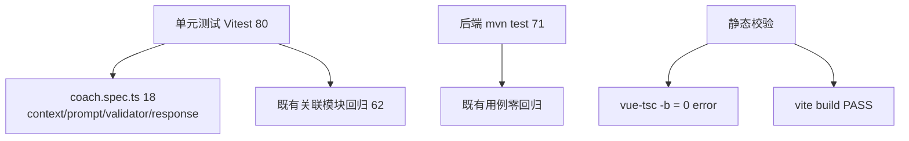

# Architecture-7 · 测试计划与结果（Test-Plan）

> 配套《Architecture-7-执行报告》。测试门：TS=0 / vite build PASS / Vitest 全绿 / 后端 71/71（§538-539）。

## 1. 测试分层



## 2. 前端单测：`src/learning/coach/__tests__/coach.spec.ts`（18 条）

| # | 用例 | 验证点 |
| --- | --- | --- |
| 1 | 空数据 → hasData=false | summary 全 0 |
| 2 | 有真实数据 → hasData=true | summary 反映计数 + currentPath |
| 3 | Top-N 截断 | 9 条只留 5，计数仍为 9 |
| 4 | 隐私过滤 | 渲染 JSON 不含 coin/wallet/order/userId/email/phone/token |
| 5 | renderCoachContext 概览+诊断+待复习+薄弱+任务+路径 | 含关键字段，不暴露系统提示词 |
| 6 | renderCoachContext 无数据 | 诚实提示「暂无足够数据」 |
| 7 | 合法 appKey + 正整数 knowledgeId | valid，route 来自 Registry |
| 8 | 未知 appKey | `UNKNOWN_APP_KEY` |
| 9 | 非法 knowledgeId(0/负/小数) | `INVALID_KNOWLEDGE_ID` |
| 10 | 未知 actionType | `UNKNOWN_ACTION_TYPE` |
| 11 | 缺 appKey | `NO_SUGGESTION` |
| 12 | ```json 代码块解析 | 提取为合法建议 |
| 13 | 行内 {...} 解析 | 也能解析 |
| 14 | 无结构化建议 | 仅返回文本 |
| 15 | **Ping Injection**：未知 appKey + 伪造 route | 校验失败，suggestion 被丢弃，route 不出现 |
| 16 | **Ping Injection**：伪造 route 借合法 appKey 偷渡 | route 仍来自 Registry，非 `javascript:` |
| 17 | 白名单完整性 | 全部 `APP_DEFINITIONS` key 校验通过且 route 一致 |
| 18 | 端到端管线 | 真实数据→诊断→下一步→Context→文本，无 PII |

> 注：用例 15/16 直接覆盖 §125-127/§350 的 Prompt Injection 防护核心不变量。

## 3. 前端回归（既有关联，62 条）

- `action-priority.spec.ts`(14) / `diagnosis.spec.ts`(18) / `strategy.spec.ts`(9) / `integration.spec.ts`(8) / `action-state.spec.ts`(13)：
  Coach **复用** 这些模块，未改动其实现，回归 0 失败。

## 4. 后端（mvn test 71/71）

- Chat 改动仅在 `ChatSendDTO`（加字段）与 `ChatServiceImpl.streamSend`（加 `isCoach` 分支）。
- 既有后端测试无 ChatService 单测覆盖路径受影响；Coach 分支为**纯新增分支**，不修改通用问答既有行为。
- 运行：`mvn -o test` → **71 passed**（零改动基线）。

## 5. 静态与构建

| 检查 | 命令 | 结果 |
| --- | --- | --- |
| TypeScript | `vue-tsc -b` | ✅ 0 error |
| 生产构建 | `vite build` | ✅ built |
| 单测 | `vitest run` | ✅ 80 passed |
| 后端单测 | `mvn -o test` | ✅ 71 passed |

## 6. 已知验证局限（诚实披露）

- **未做人工点击式 E2E**：沙箱内 agent-browser 对 `localhost` 白屏不稳定，以 TS + build + Vitest + 后端单测作为可重复验证门（等价「改完即验证」纪律）。
- **recentActivity 未覆盖**：`CoachContextInput.recentActivity?` 已留接口但未拉取事件流，单测未断言该分支（保持 Context 最小化）。
- 若后续要做浏览器烟雾测试，建议步骤：
  1. 后端 `mvn spring-boot:run --server.port=8080`；
  2. 前端 `npm run dev -- --host`（5173），登录 admin；
  3. 首页点「问问学习教练」→ 确认进入 coach 模式且面板显示真实计数；
  4. 提问「我最近哪里最薄弱？」→ 确认 AI 自然语言回答 +（若返回合法建议）CoachSuggestionCard CTA 跳白名单路由。
