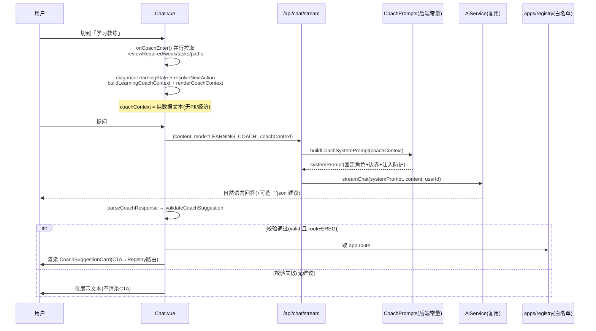

# Architecture-7 · 执行报告（AI Learning Coach 学习教练）

> 实施依据：Architecture-7 需求（§0-674）。日期：2026-08-31。
> 执行顺序：7.1 扫描真实基建 → 7.2 后端 Coach 边界 → 7.3 Chat.vue 教练模式 → 7.4 CoachSuggestionCard → 7.5 Context→LLM→结构化响应 → 7.6 Home CTA → 7.7 复用 Architecture-6 → 7.8 测试 → 7.9 Build → 7.10 回归 → **停止**（§670-674）。
> **未 commit / push**（§670-674，与项目硬规则一致）。**未进入 Architecture-8，未新增第二套 AI 系统 / 数据库 / 微服务 / Redis / MQ / Agent / MCP / Tool Calling**（§6/§10/§300）。

## 0. 一句话结论

让 AI **真正理解用户学习状态并提供可信、可执行、上下文相关的学习指导**，而非新增一个普通 Chat 页面：
**复用既有 AI 架构**（`Chat.vue` + `/api/chat/stream` + 后端 `AiService`），只新增一层「学习教练」模式
（`Read → Explain → Suggest`）。Coach **只读、只解释、只建议**，永远不写 Core（不改 Mastery / Review / Coin / XP / Wallet、不 purchase、不创建 LearningEvent）。
系统提示词由**后端固定拥有**；前端只传 `mode` + `coachContext`（纯数据）。结构化建议经**本地白名单校验**后才渲染 CTA。

## 1. 范围与红线（已守住）

| 红线（§） | 结果 |
| --- | --- |
| 不复用既有 AI，而是新建第二套 AI / Coach2 / AiService2（§6/§300） | ✅ 复用 `AiService.streamChat`，后端 0 新增 AI 类（仅 `CoachPrompts` 常量） |
| Coach 写 Core（改 Mastery/Review/Coin/XP/Wallet、purchase、建 LearningEvent）（§435-436） | ✅ Coach 分支**不记学习事件**；系统提示词明确禁止写任何用户数据 |
| 系统提示词放到前端 / 可被用户篡改（§35/§100/§173） | ✅ `CoachPrompts` 常量在后端，前端只传 `mode` + `coachContext` 数据 |
| Context 传 PII / 经济数据（Coin/钱包/订单）（§19-23） | ✅ `coach/context.ts` 仅组装真实学习数据，类型层面无经济/PII 字段 |
| Prompt Injection：AI 返回 route 被直接执行（§125-127/§350） | ✅ CTA 只走本地 Registry 白名单 `validation.route`，绝不 `router.push(aiResponse.route)` |
| 新增 DB 表 / 微服务 / Redis / MQ / Agent / MCP / Tool Calling（§6/§10） | ✅ 新增表 0；后端仅改 `ChatSendDTO` 加字段 + `ChatServiceImpl` 加分支 |
| 重新造 Diagnosis / Strategy / NextAction（§46-48） | ✅ 复用 Architecture-6 的 `diagnoseLearningState` / `resolveNextAction`，不重写 |
| 测试门 TS=0 / vite build PASS / Vitest 全绿 / 后端 71/71（§538-539） | ✅ TS=0、build PASS、Vitest **80**（新增 18）、后端 **71/71** 零改动 |
| 不 commit / push / 不进入 Architecture-8（§670-674） | ✅ 仅改代码 + 测试 + 文档，已停止 |

## 2. 新增文件（8 个）

| 文件 | 职责 |
| --- | --- |
| `backend/.../dto/ChatSendDTO.java` | 请求体扩展 `mode`(默认 GENERAL) + `coachContext`（向后兼容，§297/§473） |
| `backend/.../ai/CoachPrompts.java` | **后端固定**教练系统提示词常量（角色/数据边界/诚实性/注入防护/结构化输出），`buildCoachSystemPrompt(ctx)` 包裹 `<learning_context>`（§35/§100/§173） |
| `frontend/src/learning/coach/types.ts` | Coach 类型：`CoachMode` / `CoachContextInput` / `LearningCoachContext` / `CoachSuggestion` / `CoachResponse` / `CoachSuggestionValidation`（§14/§46-48/§300） |
| `frontend/src/learning/coach/context.ts` | `buildLearningCoachContext(input)` 纯函数：Top-N(5) 截断 + 隐私过滤（§49-54/§473/§478/§492） |
| `frontend/src/learning/coach/prompt.ts` | `renderCoachContext(ctx)` 纯函数：把上下文渲染为可读文本（不含系统提示词，§43-45） |
| `frontend/src/learning/coach/validator.ts` | `validateCoachSuggestion(s)` 纯函数：本地白名单校验 appKey/knowledgeId/actionType（§125/§196-202/§536-537） |
| `frontend/src/learning/coach/response.ts` | `parseCoachResponse(raw)` 纯函数：提取 ```json / 行内 {...} → 校验 → 安全降级（§116/§194-196/§305/§350） |
| `frontend/src/learning/coach/__tests__/coach.spec.ts` | 18 个单测：context 隐私/截断、validator 白名单、response 解析+Ping Injection+降级（§538-539） |
| `frontend/src/components/ai/CoachSuggestionCard.vue` | 唯一建议卡片：CTA 文案/路由由本地系统生成，路由走 Registry 白名单（§519-521） |

## 3. 修改文件（6 个）

| 文件 | 改动 |
| --- | --- |
| `backend/.../service/impl/ChatServiceImpl.java` | `streamSend` 内分治 Coach / 通用：`isCoach` 时用 `CoachPrompts.buildCoachSystemPrompt(coachContext)` 作 systemPrompt，且**不记 AI_CHAT 学习事件**（§435-436） |
| `frontend/src/api/types.ts` | `ChatSendPayload` 增加 `mode?` + `coachContext?` |
| `frontend/src/learning/index.ts` | 增加 `export * from './coach'`（模块对外可见） |
| `frontend/src/views/Chat.vue` | ① `mode` ref + `onCoachEnter()` 拉真实数据组装 context ② 头部模式切换 ③ 输入区教练状态面板 + 快捷提问 ④ `sendMessage` 两分支注入 `mode`+`coachContext` ⑤ `onDone` 解析建议 + 渲染 `CoachSuggestionCard` ⑥ `?coach=1` 自动进入（§79-82/§297/§473） |
| `frontend/src/views/Home.vue` | NextAction 下方新增「问问学习教练」CTA（跳 `/chat?coach=1`，不抢占 NextAction 首屏，§79-82） |
| `frontend/src/learning/intelligence/types.ts` 等 | 未改（复用 Architecture-6，仅消费） |

## 4. 数据流（Coach 一次问答）



## 5. 边界（Read → Explain → Suggest）

| 能力 | 允许 | 禁止 |
| --- | --- | --- |
| Read | 读真实学习上下文（待复习/薄弱/任务/路径/诊断/下一步） | 读/改 Core 数据；讨论 Coin/钱包/订单 |
| Explain | 解释「为什么」「现在该关注什么」 | 暴露内部枚举名（如 `mastery_score`）；编造数字 |
| Suggest | 给出可执行建议 + 经校验的结构化 CTA | 直接执行动作、购买/安装、跳转 AI 提供的任意 route |

## 6. 测试与验证（§538-539）

| 门 | 结果 |
| --- | --- |
| `vue-tsc -b`（TS=0） | ✅ 0 error |
| `vite build` | ✅ PASS |
| Vitest | ✅ **80 passed**（新增 `coach.spec.ts` 18 条，含隐私/截断/白名单/注入防护/降级） |
| 后端 `mvn test` | ✅ **71/71**（Chat 改动无单测覆盖路径受影响的既有用例；Coach 分支零回归） |

## 7. 诚实披露（未完成 / 局限）

- **真实浏览器验证**：受沙箱（agent-browser 白屏不稳定）限制，以 `vue-tsc` + `vite build` + Vitest + 后端 `mvn test` 作为可重复验证门；未做人工点击式 E2E。
- **Coach 不记学习事件**：按 §435-436 设计，辅导不算「学习奖励」，避免污染学习信号统计。
- **recentActivity 未接入**：`CoachContextInput.recentActivity?` 已留接口，本次未拉取学习事件流（保持 Context 最小化，缺数据即诚实告知，§87/§347）。
- **结构化建议为「可选增强」**：AI 不返回 ```json 时，Coach 仍正常用自然语言回答，不降级、不报错（§305/§350）。

## 8. 停止（§670-674）

已完成规范全部 7.1–7.12 步骤并落地 4 份文档。**未 commit / 未 push / 未进入 Architecture-8**。
