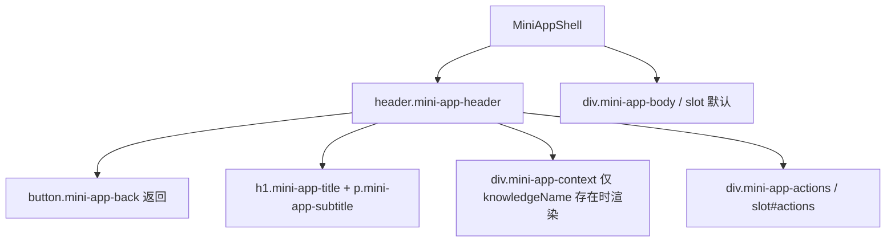

# KnowFlow UI/UX 2.0 设计规范（Design Rules）

> 统一设计令牌 / Mini App 壳 / 响应式 / 暗色 / 可访问性 / 禁则
> 关联文档：`UI-UX-2.0-执行报告.md` / `UI-UX-2.0-Information-Architecture.md`

---

## 1. 设计系统：继续 `--kb-*`，不新建第二套（§133-141）

UI/UX 2.0 **不引入** 任何第二套 Card / Button / Modal / Toast / 字体 / 配色。一切沿用 `frontend/src/style.css` 中的 `--kb-*` 令牌体系。

| 类别 | 令牌（节选） | 说明 |
|---|---|---|
| 主色 | `--kb-primary` `#3B6FE0` | 主按钮、链接、高亮、active |
| 主色软背景 | `--kb-primary-soft` `rgba(59,111,224,0.08)` | 选中态 / 聚焦光晕背景 |
| 背景 | `--kb-background` `#F7F8FA`、卡片 `--kb-card` `#FFFFFF` | 页面与卡片 |
| 文字 | `--kb-foreground` / `--kb-muted-foreground` | 主文 / 次要文 |
| 边框 | `--kb-border` | 分隔线、卡片描边 |
| 圆角 | `--kb-radius-sm` / `--kb-radius-md` | 按钮 / 卡片统一圆角 |
| 强调态 | `--kb-state-success` / `--kb-state-warning` / `--kb-state-error` / `--kb-state-info` | 成功 / 警告 / 错误 / 信息 |
| 焦点环 | `--kb-ring` | `focus-visible` 描边（可访问性） |
| 字号 | `--kb-fs-h2` `32px` / `--kb-fs-body-sm` `13px` / `--kb-fs-caption` `12px` … | Typography 分级 |
| 间距 | 4px 基数（`--kb-nav-gap` 等） | 统一间距栅格 |
| 侧栏 | `--kb-sidebar` / `--kb-sidebar-foreground` | 左栏与文字 |

**统一约定（五项 UI 原则）**：
1. 布局间距统一基数（4px 栅格）。
2. 字号 / 字重 / 行高分级（`--kb-fs-*` / `--kb-fw-*` / `--kb-lh-*`）。
3. 交互元素必须有 hover / active / focus 反馈，**禁「死按钮」**。
4. 统一图标（`Icon.vue` lucide 风格，不引入 emoji / 新图标库）。
5. 响应式不错位、不横向溢出。

---

## 2. 统一 Mini App 壳（§94-99 / §213-216）

所有学习工具（测验 / 闪卡 / 错题 / 费曼 / 编程 …）共享一个外壳 **`frontend/src/components/layout/MiniAppShell.vue`**：

**API（props / emits）**：

| 名称 | 类型 | 说明 |
|---|---|---|
| `title` | `string`（必填） | App 名 |
| `subtitle` | `string?` | 一句简介（如「AI 生成练习」） |
| `knowledgeName` | `string?` | 上下文：有值才显示「正在学习：X」（§100-101，无则不显示空态） |
| `backLabel` | `string?` | 返回按钮 aria 文案 |
| `clearableContext` | `boolean?` | 是否显示清除上下文按钮 |
| `@back` | `()` | 返回（业务自行决定 `router.back()` 或回学习中心） |
| `@clear-context` | `()` | 清除知识上下文 |

**规则**：
- 返回键用真实 `<button>`（§302-307，禁止 clickable div 冒充导航）。
- 上下文仅在有 `knowledgeName` 时渲染，无则不渲染空态（§101）。
- 各 App 只写自身内容，保留内容特色；壳只提供「返回 / 标题 / 上下文 / 动作 / 内容」骨架（§95-96）。
- 全部 `--kb-*` 令牌，深色自动跟随；移动端 `<640px` 时 context 折行到下一行（`order:3; flex-basis:100%`）。

**参考实例**：`frontend/src/views/SmartQuiz.vue` 已接入（header + context-bar 替换为 `MiniAppShell`，保留 `#actions` 新建题目按钮）。

---

## 3. 容器 / 间距 / 圆角 / 按钮高度（§133-141 统一）

- 容器最大宽度统一（CLayout 主区已约束）。
- 卡片：`background: var(--kb-card)` + `border: 1px solid var(--kb-border)` + `border-radius: var(--kb-radius-md)` + padding 16~24px。
- 主按钮：高 34~38px、`border-radius: var(--kb-radius-sm)`、`background: var(--kb-primary)`、hover `opacity:.9`、`:disabled` `opacity:.5`。
- 次级按钮：`btn-ghost` 透明背景 + hover `var(--kb-muted)`。

---

## 4. 响应式断点（§205 / §311-330）

| 断点 | 适配要点 |
|---|---|
| 390（移动） | 底部导航 ≤4~5 Tab；Mini App 壳 context 折行；网格单列 |
| 768（平板） | 侧栏可收起；配置卡单列→多列 |
| 1024 / 1280 | 双栏布局展开（如 Wallet 网格、Quiz 2:1 网格） |
| 1440（桌面） | 主内容最大宽度约束，两侧留白 |

---

## 5. 暗色模式（§308-310）

- 不新建暗色样式；所有组件走 `--kb-*` 令牌，`:root[data-theme='dark']` 已定义对应变量，自动跟随。
- 验收要求：**全页面** 暗色检查（导航 / Mini App / 弹层 / 下拉菜单），无硬编码色值遗漏。

---

## 6. 可访问性（§302-307）

- 导航 / 返回 / 菜单项一律真实 `<button>` / `<a>` / `router-link`，**禁止 clickable div 冒充导航**。
- 焦点可见：`:focus-visible` 用 `box-shadow: 0 0 0 2px var(--kb-ring)`。
- 语义：`role="menu"` / `role="menuitem"`、`aria-current="page"`、`aria-label`、`aria-expanded`。
- 键盘可达：Tab 顺序合理，Enter/Space 可触发。

---

## 7. 禁则（UI/UX 2.0 红线）

1. ❌ 新增第二套设计系统 / 组件库（Material / Ant / Element / 自定义 token）。
2. ❌ 硬编码颜色 / 字号 / 间距 / 圆角（必须走 `--kb-*`）。
3. ❌ 新增一级导航（保持 5 个：首页 / 学习 / 知识 / AI / 应用）。
4. ❌ 用 div + @click 冒充可导航元素。
5. ❌ 为「降噪」而删减能力 / 删路由（下沉 ≠ 删除）。
6. ❌ 触碰后端业务 / 新增 API / 新增 DB 表（本次纯前端重构）。
7. ❌ 改动 Reward / Mastery / SRS / Learning Intelligence / NextAction Resolver / Purchase / Entitlement / UserApp。

---

## 8. 组件落地检查表（用于后续接 MiniAppShell）

| Mini App | 当前头部 | 建议 |
|---|---|---|
| 智能测验 `SmartQuiz.vue` | ✅ 已接 `MiniAppShell` | 完成（参考实例） |
| 闪卡 `FlashCardsHub.vue` | 自造 header | 建议接入 |
| 错题 `Mistakes.vue` | 自造 header | 建议接入 |
| 费曼 / 编程练习等 | 自造 header | 后续增量接入 |

> 接入为**低优先级增量**（§351 鼓励但非阻断）；不接入也不违背 2.0 红线，仅一致性略有差异。
