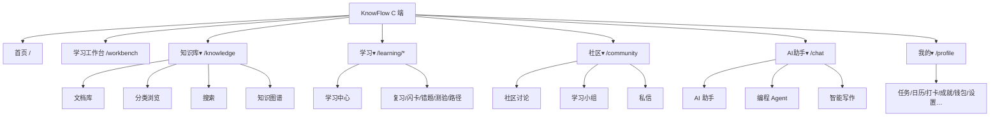

# KnowFlow UI/UX 2.0 信息架构（Information Architecture）

> 导航收敛方案 · 单一数据源 `frontend/src/config/navigation.ts` · Before → After
> 关联文档：`UI-UX-2.0-执行报告.md` / `UI-UX-2.0-Design-Rules.md`

---

## 1. 设计原则

1. **按用户任务组织，而非按数据库表 / Controller 组织**（§12-17）。
2. **少入口，不减少能力**（§25-26）：入口收敛 ≠ 功能删减；被下沉的路由全部保留、深链可用（§259-267）。
3. **单一数据源（SSoT）**：桌面侧栏 `CSidebar`、顶栏 `CTopNav`、移动端底部导航、面包屑 `buildCrumbs`、高亮 `findGroupByPath` 全部只读 `NAVIGATION`。
4. **移动端底部导航 ≤4~5 个最高频 Tab**（§105/§207）：首页 / 学习 / 知识 / 应用；AI 经顶栏「AI 助手」按钮进入（§107）。

---

## 2. Before：7 个一级入口（过载）

来源：Phase UI-2 前的 C 端结构（知识库 / 社区 / 学习 / AI / 我的 / 应用 + 学习工作台重复）。



**问题**：8 个顶级入口、学习工作台重复、Header 承担本该由导航承担的 30 个二级项（§26-27），移动端底部放不下。

---

## 3. After：5 个一级入口（收敛）

来源：当前 `frontend/src/config/navigation.ts` 的 `NAVIGATION`。

```mermaid
graph TD
  Root[KnowFlow C 端]
  Root --> H[首页 /]
  Root --> L[学习▾]
  Root --> K[知识▾]
  Root --> A[AI▾]
  Root --> App[应用 /apps]

  L --> L1[学习中心 /learning/center]
  L --> L2[今日计划 /learning/today-plan]
  L --> L3[学习路径 /learning/paths]
  L --> L4[复习计划 /learning/review]
  L --> L5[闪卡 /learning/flashcards]
  L --> L6[错题本 /mistakes]
  L --> L7[智能测验 /learning/quiz]
  L --> L8[代码练习 /learning/code-practice]
  L --> L9[挑战 /challenge]
  L --> L10[掌握度 /learning/mastery]
  L --> L11[学习报告 /learning/report]
  L --> L12[学习工作台 /workbench]
  L --> L13[番茄钟 /learning/pomodoro]
  L --> L14[专注模式 /learning/focus]

  K --> K1[知识库 /knowledge]
  K --> K2[文档库 /docs]
  K --> K3[分类浏览 /categories]
  K --> K4[搜索 /search]
  K --> K5[知识图谱 /learning/knowledge-graph]
  K --> KC[社区讨论 /community]:::merged
  K --> KG[学习小组 /study-group]:::merged
  K --> KM[私信 /messages]:::merged

  A --> A1[AI 助手 /chat]
  A --> A2[编程 Agent /coding/agent]
  A --> A3[智能写作 /learning/writing]

  App --> App1[应用中心 /apps]

  classDef merged fill:#DBE6FC,stroke:#3B6FE0,color:#1E3A6B;
```



**下沉映射**：
- 「学习工作台」→ 并入「学习」组 children（`/workbench`）。
- 「社区」3 项 → 并入「知识」组 children（围绕知识的社会化维度，§17）。
- 「我的」10 项（任务 / 日历 / 打卡 / 成就 / 钱包 / 设置 …）→ 全部收进顶栏头像下拉菜单（§20-21/§110-112）。

---

## 4. 移动端底部导航（§105/§207）

仅收录 `mobilePrimary: true` 的顶级入口：

```mermaid
flowchart LR
  MF[🏠 首页] --> ML[📚 学习] --> MK[🗂 知识] --> MA[✨ AI按钮(顶栏)] --> MB[🧩 应用]
```

- AI 经顶栏「AI 助手」图标按钮进入，不占底部 Tab。
- 「我的」在移动端同样经右上角头像菜单进入。

---

## 5. 头像菜单（吸收「我的 + 社区」）

`CTopNav.vue` 的 user-menu 分区下拉，所有项用真实 `<button role="menuitem">` + `goTo(path)`：

| 分区 | 入口（路由） |
|---|---|
| 个人 | 个人中心 `/profile`、钱包 `/wallet` |
| 学习 | 我的任务 `/tasks`、任务清单 `/task-list`、日历 `/calendar`、每日打卡 `/check-in`、习惯打卡 `/habits` |
| 成长 | 成就 `/achievements`、称号 `/kb-titles` |
| 内容 | 收藏夹 `/favorites`、笔记 `/notes` |
| 社区 | 社区讨论 `/community`、学习小组 `/study-group`、私信 `/messages` |
| — | 背景设置 `/settings/background`、管理后台 `/admin/overview`（admin）、退出登录 |

---

## 6. 路由保留清单（深链不受影响，§259-267）

所有历史路由在 `router/index.ts` 中保持不变，仅导航呈现方式变化：

- 一级直达：`/`、`/apps`
- 学习：`/learning/center`、`/learning/today-plan`、`/learning/paths`、`/learning/review`、`/learning/flashcards`、`/mistakes`、`/learning/quiz`、`/learning/code-practice`、`/challenge`、`/learning/mastery`、`/learning/report`、`/workbench`、`/learning/pomodoro`、`/learning/focus`
- 知识：`/knowledge`、`/docs`、`/categories`、`/search`、`/learning/knowledge-graph`、`/community`、`/study-group`、`/messages`
- AI：`/chat`、`/coding/agent`、`/learning/writing`
- 头像菜单：`/profile`、`/wallet`、`/tasks`、`/task-list`、`/calendar`、`/check-in`、`/habits`、`/achievements`、`/kb-titles`、`/favorites`、`/notes`、`/settings/background`、`/admin/overview`

---

## 7. 派生能力（由 SSoT 自动保证一致）

- **面包屑**：`buildCrumbs(path)` 命中二级 → `[分组]/[子项]`；命中顶级 → `[分组]`；未命中（详情页）→ 由页面 `PageHeader` 补末级。
- **高亮**：`isGroupActive` 父级高亮（进入 `/learning/review` 时「学习」保持 active）；`aria-current="page"` 标当前项。
- **可访问性**：分组用 `<button>`（Enter/Space 展开），链接用 `router-link`，折叠态图标保留 `title` + `aria-label`（§17/§54）；头像菜单 `role="menu"` + `role="menuitem"`（§302-307，禁止 clickable div 冒充导航）。
- **深色模式**：导航全部走 `--kb-*` 令牌，自动跟随。
