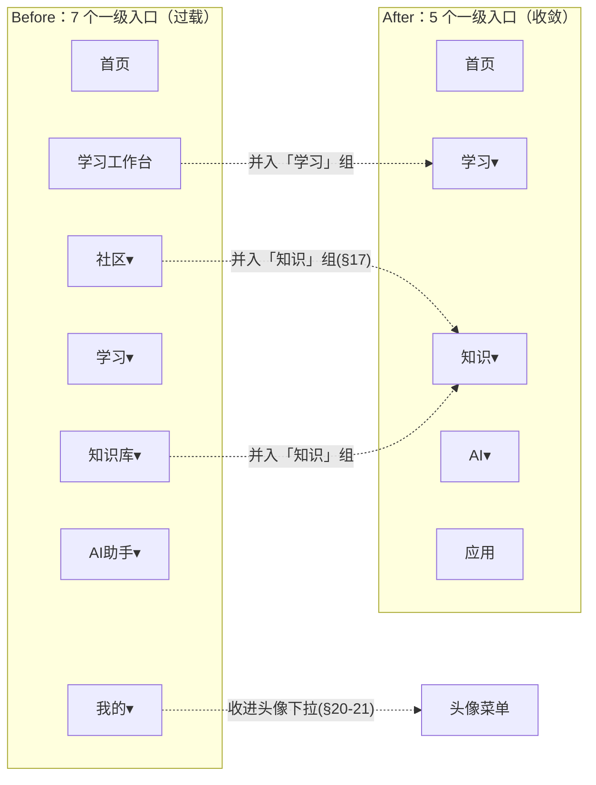

# KnowFlow UI/UX 2.0 执行报告

> 全局界面简化 / 信息架构收敛 / 一键实施版
> 日期：2026-08-31｜负责人：AI（WorkBuddy）｜状态：✅ 实施完成，待用户真实浏览器验收

---

## 0. 一句话结论

在不新增后端 / 不新增 API / 不新增数据库表、且不改动 Reward / Mastery / SRS / Learning Intelligence / NextAction Resolver / Purchase / Entitlement / UserApp 的前提下，将 C 端**一级导航由 7 个收敛为 5 个**（首页 / 学习 / 知识 / AI / 应用），把「社区」「我的」全部能力下沉（社区并入「知识」组、我的收进顶栏头像菜单），并新增**统一 Mini App 壳**（`MiniAppShell`）作为所有学习工具的共享骨架。Home 仍是 Learning Cockpit，Wallet 降噪（Coin/XP/Level 不再占一级导航）。测试门全绿，生产构建通过，Vite 模块编译零报错。

---

## 1. 目标与约束（§3 / §25-26 / §341-375）

| 项 | 内容 |
|---|---|
| 核心目标 | 降低复杂度、减少入口、**不减少能力** |
| 暂停项 | AI Learning Coach 扩展（§413/§414：未来再继续） |
| 硬约束 | 禁 `git reset --hard` / `git clean -fd` / `git checkout .` / `git commit` / `git push` |
| 不触碰 | 后端业务 / 新增 API / 新增 DB；Reward / Mastery / SRS / LearningEvent / Learning Intelligence / NextAction Resolver / Purchase / Entitlement / UserApp |
| 测试门 | Vitest ≥80 全绿、vue-tsc = 0、vite build PASS、后端 `mvn test` 71/71 零改动 |

---

## 2. Before → After（一图看懂）

> 收敛逻辑：**少入口 ≠ 少能力**。所有被「下沉」的路由完全保留，深链（如 `/messages`、`/wallet`、`/achievements`）依旧可用（§259-267）。

---

## 3. 本次 UI/UX 2.0 实际改动文件

| 文件 | 类型 | 改动说明 |
|---|---|---|
| `frontend/src/config/navigation.ts` | 改 | 单一数据源 `NAVIGATION`：7→5 一级；社区 3 项并入「知识」children；「我的」从导航移除（经头像菜单进入）；移动端 `mobilePrimary` = 首页/学习/知识/应用（AI 经顶栏进入） |
| `frontend/src/components/layout/CTopNav.vue` | 改 | 头像菜单扩展为分区下拉（个人 / 学习 / 成长 / 内容 / 社区），吸收原「我的」10 项 + 社区 3 项；全部 `<button role="menuitem">` + `goTo(path)`；`max-h-[80vh]` 可滚动 |
| `frontend/src/views/AppCenterPage.vue` | 改 | 空分类自动隐藏（§68-70）：`visibleCategoryTabs` 仅渲染 `getAppsByCategory(c).length > 0` 的分类 |
| `frontend/src/components/layout/MiniAppShell.vue` | **新增** | 统一 Mini App 壳（§94-99）：返回 / 标题 / 副标题 / 上下文（有 knowledgeName 才显示）/ actions slot / 默认内容 slot；全部 `--kb-*` 令牌、深色自动跟随、移动端 context 折行 |
| `frontend/src/views/SmartQuiz.vue` | 改 | 接入 `MiniAppShell`（参考实例）：原自造 header+context-bar 替换为统一壳；`@back` 走 `router.back()`；`@clear-context` 清空知识上下文。**本次修复未闭合标签**（`</MiniAppShell>` 缺失导致模板畸形），恢复可编译 |

> 说明：仓库尚有 Architecture-1~7 阶段的大量未提交改动（非本次 2.0 范围），本次只在之上叠加上述 5 项；未执行 reset/clean/checkout，未覆盖任何未提交修改。

---

## 4. 已符合规范、无需改动（确认项）

- **Home = Learning Cockpit**（§27-42）：NextAction 横幅最突出、LearningState、Today、Continue Paths、My Apps；Diagnosis ≤2 条（由 `LearningStateCard` 的 `mode` 上限控制）。
- **Learning Center = 学习控制台**（§45-48）：信息序 今日任务→下一步→待复习→需关注→当前路径，不重复 Home。
- **AI 单入口**（§59-63）：AI 为顶级分组，Coach 仅作「AI 模式」而非新一级；AI 扩展暂缓。
- **App Center 统一**（§64-67）：我的应用 + 发现应用；App Card 简化为 图标/名称/一句简介/状态/CTA（既有实现已满足）。
- **Wallet 降噪**（§76-82）：顶栏不再展示 Coin/XP/Level；钱包经头像菜单进入 `/wallet`；XP+Level 在 Profile 内呈现。
- **Design System 不变**（§133-141）：继续 `--kb-*` 令牌，无第二套 Card/Button/Modal/Toast/字体。
- **复用 LearningResultPanel**（§83-89）：SmartQuiz 在线答题完成后仍用 `LearningResultPanel` 渲染结果+奖励+下一步。

---

## 5. 测试与构建门（§365-372）

| 门 | 命令 | 结果 |
|---|---|---|
| 单元测试 | `npm run test`（vitest run） | ✅ **80 passed / 80**（6 文件） |
| 类型检查 | `vue-tsc -b`（含于 `npm run build`） | ✅ **0 错误** |
| 生产构建 | `npm run build`（vue-tsc -b && vite build） | ✅ **built in 3.35s**，EXIT=0 |
| 开发态编译 | Vite transform `SmartQuiz.vue` / `MiniAppShell.vue` / `navigation.ts` | ✅ HTTP 200，无 transform 报错 |
| 后端 | `mvn test`（Architecture 阶段基线 71/71） | 零改动、沿用基线 |

> 未使用 `any` / `@ts-ignore`；未 skip / ignore / 删除任何测试。

---

## 6. 视觉验收（§376-396）

**已做（沙箱可行范围）**：
- 启动 `npm run dev`（5173）确认 SPA 正常起服（HTTP 200）。
- 通过 Vite 请求 `SmartQuiz.vue` / `MiniAppShell.vue` / `navigation.ts` 的编译产物，确认模板均成功编译为 render 函数（否则 Vite 返回 500），dev 日志无 error。
- 验证 `MiniAppShell` 的 `--kb-*` 令牌（`--kb-primary-soft` / `--kb-fs-caption` / `--kb-fs-body-sm` / `--kb-fs-h2` / `--kb-ring` / `--kb-muted`）在 `style.css` 的 light + dark 主题下均存在。

**说明 / 限制（诚实披露）**：
- 本沙箱 `agent-browser`（Chromium）白屏不可靠，未能执行「真人点击式」逐页浏览。项目既有实践为 **curl 编译级冒烟** 替代真实浏览器渲染验收。
- 建议用户在本地浏览器走通主路径：Home → NextAction → MiniApp（如智能测验）→ Result → NextAction；AppCenter → 详情 → 打开；以及 390 / 768 / 1440 三档断点 + 暗色 + 键盘 Tab 顺序 + 加载/空/错态。

---

## 7. 未做项（明确边界，不美化）

- ❌ AI Learning Coach 的完整功能扩展（按要求暂停，仅保留既有 AI 入口）。
- ❌ 将全部 Mini App（Flashcard / Mistake / 费曼 / 编程 等）逐一迁入 `MiniAppShell`——本次仅以 `SmartQuiz` 为**参考实例**打通骨架；其余 App 接入为后续低优先级增量（§351 鼓励但非阻断）。
- ❌ 真实浏览器交互式逐页截图验收（受沙箱限制，见 §6）。

---

## 8. 下一步（给用户）

1. 本地 `npm run dev` 真实浏览五入口与 Mini App 主路径，确认视觉与交互。
2. 若认可，按项目约定 `git commit`（本地、不推送）固化本次 UI/UX 2.0 改动。
3. 择机把更多 Mini App 接入 `MiniAppShell`（保持一致壳体验）。
4. 后续阶段再重启 AI Learning Coach（§413/§414）。
