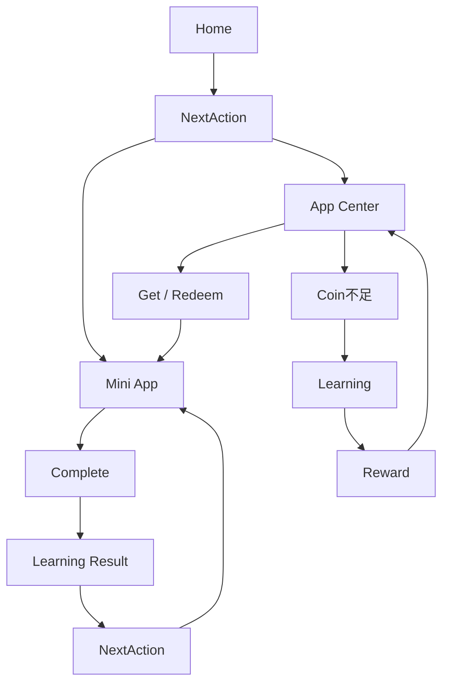

# UI/UX 2.2 · Learning Flow（学习主链路）

> 学习主链路精修 + 状态组件统一 + 上下文连续性。
> 本文档用一张主链路图说明「用户始终知道下一步」如何落地，并定义各枢纽节点的职责语义。
> 配套：执行报告 `UI-UX-2.2-执行报告.md`、状态清单 `UI-UX-2.2-State-Inventory.md`、浏览器验收 `UI-UX-2.2-Browser-Verification.md`。

## 1. 主链路 Flowchart



### 1.1 上下文连续性分支（Context Continuity）

```mermaid
flowchart TD
    KNOW[Knowledge 详情] -->|带 knowledgeId| QUIZ[/learning/quiz?knowledgeId=123]
    KNOW -->|带 knowledgeId| FLASH[/learning/flashcards?knowledgeId=123]
    QUIZ --> CTX1[MiniAppShell 显示 正在学习：X]
    FLASH --> CTX2[MiniAppShell 显示 正在学习：X]
    CTX1 --> CLEAR1[清除 → UI 同步隐藏]
    CTX2 --> CLEAR2[清除 → UI 同步隐藏]

    NEXT[NextAction 薄弱点] -->|buildWeakAppAction 带 knowledgeId| QUIZ
    NEXT -->|buildWeakAppAction 带 knowledgeId| FLASH
```

- 透传链：`buildWeakAppAction`（`learning/action-priority.ts:150`）→ 产出带 `knowledgeId` 的 `MINI_APP` 动作 → `NextActionCard.doAction` 经 `buildMiniAppContextQuery`（`learning/route.ts`）写入 `router.push({ path, query: { knowledgeId, knowledgeName } })` → Flashcard/Quiz 经 `route.query` 显示「正在学习：X」。
- 无 `knowledgeId` 的 App（Mistake/Feynman/Cornell/Memory Palace/Coding/Mindmap/Notes/Drawing）**不显示**「正在学习：X」（不伪造，规范 §50）。
- 刷新保持：`route.query` 天然持久；返回不丢 Home/Learning Center 状态（规范 §54-55）。

## 2. 枢纽节点职责语义

| 节点 | 角色 | 职责 |
| --- | --- | --- |
| Home | Decision | 只突出 NextAction + LearningState(≤2) + Continue Path + My Apps；不堆卡片 |
| Learning | Plan | 学习中心：今日行动 + 待复习明细 + 当前路径；≤3 重点诊断 |
| Knowledge | Content | 知识库内容源；进入 Quiz/Flashcard 时携带 knowledgeId 上下文 |
| Mini App | Action | 统一外壳（MiniAppShell）：back/title/subtitle/context/actions；第一屏突出当前主要任务 |
| Result | Feedback | LearningResultPanel：完成 / 结果 / 奖励 / 学习状态 / 下一步；无真实数据不显示 |
| App Center | Capability | Get/Redeem 入口；优先说明「能解决什么问题」，价格第二层 |

## 3. 学习闭环语义

| 概念 | 含义 | 真实来源 |
| --- | --- | --- |
| LearningEvent | Fact | 真实学习行为落库（答题/闪卡复习/代码提交/错题标记/任务完成） |
| Mastery | State | 知识点掌握度（真实 scoring，无前后快照时只显示「掌握度已更新」） |
| Review | Schedule | SM-2 复习队列（SrsService 唯一实现） |
| Reward | Incentive | 钱包 diff（+X XP / +Y Coin），仅真实奖励才展示 |
| NextAction | Next Step | 纯函数 Resolver（REVIEW>TASK>WEAK>PATH>EXPLORE），循环保护 |

## 4. 状态统一语义（Loading / Empty / Error）

| 状态 | 统一为 | 组件 |
| --- | --- | --- |
| Loading | Skeleton（非「Loading...」） | `SkeletonList` / `StateView`(loading) |
| Empty | 标题 + 说明 + 可选 CTA(≤1) | `EmptyState` / `StateView`(empty) |
| Error | 友好文案 + 重试（不暴露 500/异常） | `ErrorState` / `StateView`(error) |

> 共享组件已存在（`EmptyState`/`ErrorState`/`SkeletonList`/`StateView`），本阶段不做 V2 抽象；采用率不均衡留作后续独立收敛批次。

## 5. CTA 一致性

| App 状态 | CTA | 说明 |
| --- | --- | --- |
| 免费 + 未安装 | 获取 | 安装后打开 |
| 付费 + 未拥有 | 兑换 · N Coin | Coin 足够转 App Center 兑换 |
| 已拥有 | 打开 | 直接打开 |
| 平台停用 | 暂不可用 | 禁用，不购买/进入 |
| 已安装 + 用户停用 | 重新启用 | 无需再购买 |
| 付费 + Coin 不足 | 去学习赚取 | 回学习中心（非钱包），学习→奖励→Coin→再回来 |

学习类 CTA 统一：开始复习 / 继续学习 / 开始练习 / 查看错题 / 继续路径；不混用 安装/下载/领取/购买/解锁。
